# POP'N UP

<div align="center">

### 팝업스토어 탐색부터 예약 · 결제 · QR 체크인까지 한 번에

**흩어져 있는 팝업스토어 정보를 한곳에서 탐색하고,  
예약부터 결제, QR 체크인까지 하나의 흐름으로 연결하는 팝업스토어 통합 플랫폼**

<br>


</div>

---

## 목차

- [프로젝트 소개](#프로젝트-소개)
- [팀원 및 역할](#팀원-및-역할)
- [주요 기능](#주요-기능)
- [기술 스택](#기술-스택)
- [서비스 플로우](#서비스-플로우)
- [시스템 아키텍처](#시스템-아키텍처)
- [ERD](#erd)
- [기술적 의사결정](#기술적-의사결정)
- [트러블 슈팅 & 성능 개선](#트러블-슈팅--성능-개선)
- [테스트](#테스트)
- [CI/CD & AWS](#cicd--aws)
- [모니터링](#모니터링)
- [프로젝트 성과](#프로젝트-성과)
- [프로젝트 구조](#프로젝트-구조)
- [향후 개선](#향후-개선)

---

## 프로젝트 소개

### 프로젝트 배경

팝업스토어 정보는 SNS, 블로그, 포털 검색, 지도, 공식 홈페이지 등 여러 채널에 분산되어 있습니다.

이 때문에 사용자는 원하는 팝업스토어를 찾기 위해 여러 플랫폼을 직접 확인해야 하며, 관심 있는 팝업의 위치와 운영 기간, 예약 일정 등을 한눈에 비교하기 어렵습니다.

POP'N UP은 이러한 문제를 해결하기 위해 **팝업스토어 탐색 → 예약 → 결제 → QR 체크인** 과정을 하나의 서비스로 연결했습니다.

### 핵심 목표

- 팝업스토어 정보 통합 탐색
- 스케줄 기반 예약 및 정원 관리
- KakaoPay 기반 결제
- QR 기반 현장 체크인
- JWT / OAuth2 기반 인증·인가
- 동시 예약 상황에서의 데이터 정합성 보장
- 부하 테스트를 통한 병목 식별 및 성능 개선
- AWS 기반 운영 환경 및 CI/CD 구축

---

## 팀원 및 역할

> 팀원별 담당 기능은 최종 담당 범위에 맞춰 작성합니다.

| 팀원 | 담당 기능 | 기술 고도화 |
| --- | --- | --- |
| 박지오 | 회원 / 인증 / 결제 / AWS 배포 | JWT Blacklist, 결제 동시성 검증, AWS CI/CD |
| 이명인 | 예약 / 스케줄 / QR 체크인 / 팝업 크롤링 / AWS 배포 | 동시 예약/중복 예약/중복 취소 방지, 과부하 제어, 목록/일정 조회 속도 향상, 대량 예약 만료 처리, 좌석 수 자동 보정/장애 시 좌석 반환 누락 방지, 예약 대기열, AWS CI/CD |
| 팀원 3 |  |  |

---

## 주요 기능

### 회원 / 인증

- 회원가입 및 로그인
- JWT 기반 인증
- Kakao OAuth2 로그인
- 회원 정보 조회
- 비밀번호 변경
- 회원 탈퇴
- USER / ADMIN 권한 관리
- Redis JWT Blacklist 기반 로그아웃 토큰 재사용 방지

### 팝업스토어

- 팝업스토어 등록 / 조회 / 수정 / 삭제
- 팝업 카테고리 및 운영 상태 관리
- 팝업 이미지 관리
- Naver Geocoding 기반 주소 좌표 변환
- 지도 영역 기반 팝업 조회
- 사용자 위치 기반 주변 팝업 조회
- 팝업 데이터 크롤링

### 스케줄

- 팝업스토어별 예약 일정 생성
- 스케줄 일괄 등록
- 최대 정원 및 현재 예약 인원 관리
- 스케줄 조회

### 예약

- 스케줄 기반 예약 생성
- 예약 내역 조회
- 예약 취소
- 예약 상태 관리
- 동일 회원 중복 활성 예약 방지
- 동시 예약 정원 정합성 제어
- 결제 타임아웃 자동 처리
- 스케줄 종료 후 미방문 예약 처리

### 결제

- KakaoPay Ready API 연동
- KakaoPay Approve API 연동
- Payment 도메인 기반 결제 정보 관리
- PaymentStatus 기반 상태 관리
- 동일 예약 중복 결제 방지
- 동시 결제 요청 정합성 검증

### QR 체크인

- 결제 완료 예약 QR 발급
- 예약번호 기반 현장 체크인
- 중복 QR 체크인 방지
- 동시 체크인 정합성 검증

### 관리자

- 관리자 전용 API
- 회원 목록 조회
- 회원 상태 관리
- 관리자 예약 목록 조회
- 팝업 / 날짜 / 예약 상태 기반 조건 검색

---

## 기술 스택

### Backend

<p>
  
  
  
  
  
</p>

### Database & Cache

<p>
  
  
  
</p>

### Authentication & External API

- Spring Security
- JWT
- Kakao OAuth2
- KakaoPay
- Naver Geocoding
- ZXing

### Test & Performance

- JUnit 5
- MockMvc
- Testcontainers
- k6
- Spring Boot Actuator

### Infra & CI/CD

<p>
  
  
  
</p>

---

## 서비스 플로우

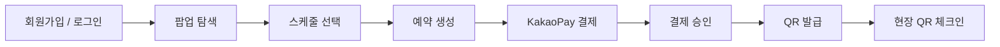

---

## 시스템 아키텍처

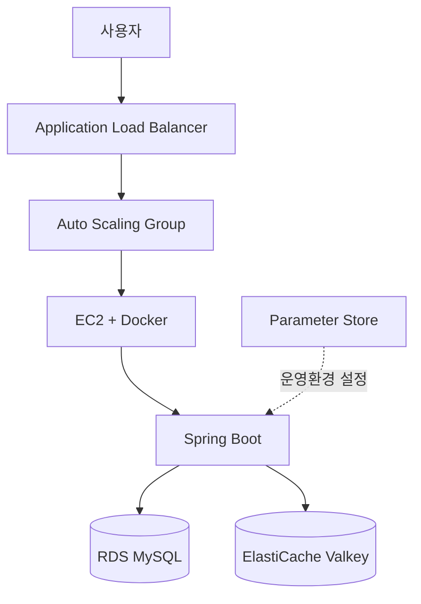

### AWS 네트워크 구성

- POP'N UP 전용 VPC
- Public / Private Subnet 구성
- NAT Gateway 구성
- Security Group 기반 접근 제어
- ALB → EC2
- EC2 → RDS MySQL
- EC2 → ElastiCache Valkey

---

## ERD

> ERD 이미지 추가 예정

주요 도메인은 다음과 같이 구성했습니다.

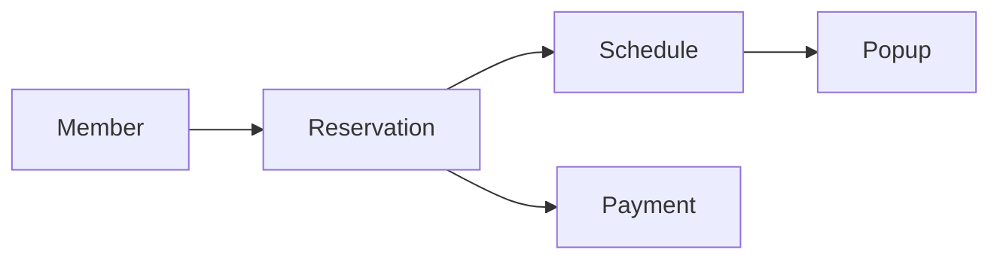

---

# 기술적 의사결정

## 1. Layered Architecture

### 선택 이유

HTTP 요청 처리, 비즈니스 로직, 데이터 접근의 책임을 분리하기 위해 `Controller → Service → Repository` 기반 계층형 구조를 사용했습니다.

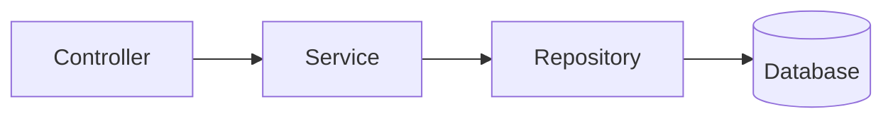

- **Controller**: HTTP 요청 및 응답 처리
- **Service**: 비즈니스 정책 및 트랜잭션 처리
- **Repository**: 데이터 접근

각 도메인을 중심으로 관련 Controller, Service, Repository, Entity, DTO를 분리하여 기능별 책임을 구분했습니다.

---

## 2. Spring Security + JWT

### 선택 이유

서버가 사용자별 세션을 관리하지 않는 Stateless 인증 구조를 구성하기 위해 JWT를 적용했습니다.

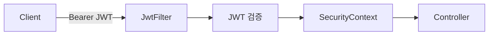

일반 사용자와 관리자는 `ROLE_USER`, `ROLE_ADMIN`으로 구분하여 API 접근 권한을 제어했습니다.

Kakao OAuth2 로그인 역시 로그인 성공 후 서비스 JWT를 발급하여 동일한 인증 체계를 사용하도록 구성했습니다.

---

## 3. Redis JWT Blacklist

### 문제

JWT는 Stateless 방식이므로 로그아웃 이후에도 토큰의 유효기간이 남아 있다면 기존 Access Token을 다시 사용할 수 있습니다.

### 적용

로그아웃된 JWT를 Redis Blacklist에 저장하고 인증 과정에서 Blacklist 등록 여부를 검사하도록 구성했습니다.

Blacklist 데이터는 JWT의 남은 유효시간을 기준으로 관리하여 만료 이후 자동으로 제거되도록 했습니다.

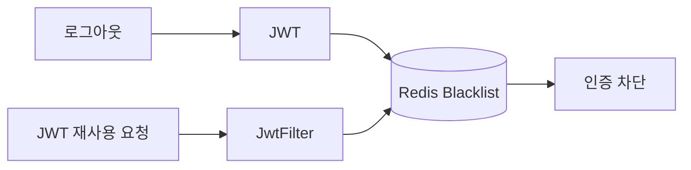

---

## 4. QueryDSL

### 선택 이유

관리자 예약 조회에서 팝업, 날짜, 예약 상태 등 여러 검색 조건을 동적으로 조합할 필요가 있었습니다.

QueryDSL의 `BooleanExpression`을 이용하여 필요한 조건만 동적으로 조합하고, Fetch Join을 이용하여 예약 조회에 필요한 연관 데이터를 함께 조회하도록 구성했습니다.

### 적용 영역

- 팝업 ID 조건
- 날짜 조건
- 예약 상태 조건
- Reservation / Member / Schedule / Popup 연관 조회


---


## 5. 세마포어

- **도입 배경**

  팝업 예약 서비스는 인기 팝업의 예약이 열리는 순간 짧은 시간에 요청이 몰립니다.

  처리 능력보다 많은 요청이 한꺼번에 들어오면 응답이 느려지고, 심하면 시간 초과로 서비스 전체가 불안정해질 수 있었습니다.

  이를 막기 위해 예약 생성 구간에 세마포어로 동시 처리 한도를 두는 과부하 제어를 도입하게 되었습니다.

- **문제**

  부하를 단계적으로 올리며 측정한 결과, 병목은 CPU나 메모리가 아니라 DB 커넥션 풀이었습니다.

  포화 구간에서도 앱 CPU 약 54%, MySQL CPU 약 24%로 여유가 있었지만 HikariCP 커넥션은 50 / 50으로 모두 사용 중이었고, 풀 크기를 20으로 줄이면 포화 시점도 약 900 → 290 req/s로 함께 당겨졌습니다.

  유입이 처리 능력을 넘으면 커넥션을 기다리는 요청이 계속 쌓여, 이미 받아 준 요청까지 느려졌습니다 (p99 약 25.8초).

  기존 RateLimiter는 초당 200,000건으로 설정되어 있어 부하 테스트에서 429 응답이 한 번도 발생하지 않았고, 과부하 보호 역할을 하지 못하고 있었습니다.

- <details>
  <summary><b>선택지</b></summary>

  - **유입량 제한 (Resilience4j RateLimiter · Bucket4j · Redisson RRateLimiter)**
    - 초당 요청 수를 제한한다. Redisson을 쓰면 여러 인스턴스의 유입량을 합쳐 제한할 수 있다.
    - 동시 실행 수 = 초당 유입 × 처리 시간이라, 요청이 느려지면 같은 유입량에서도 커넥션이 고갈될 수 있다.
    - 적정 값을 측정으로 찾아 계속 맞춰야 한다.
  - 분산 세마포어 (Redisson RSemaphore)
    - 여러 인스턴스의 동시 실행 수를 합쳐 제한할 수 있다.
    - 얻고 반납할 때마다 Redis 왕복이 필요하고, 자리를 쥔 인스턴스가 죽으면 만료 처리가 필요하다.
    - 지킬 자원(커넥션 풀)은 인스턴스마다 있어 합계 제한이 맞는 단위가 아니다.
  - Resilience4j Bulkhead
    - **동시 실행 수를 제한**한다 (내부가 세마포어 + 대기 시간).
    - 라이브러리 의존성이 추가되고, 재시도 시각 무작위 같은 동작은 따로 만들어야 한다.
  - 로컬 세마포어 (`java.util.concurrent.Semaphore`)
    - **동시 실행 수를 직접 제한**한다. 요청이 느려지면 자리가 늦게 비어 받는 양이 저절로 줄어든다.
    - 네트워크 왕복 · 외부 의존성이 없고 Redis 장애에도 그대로 동작한다.
    - 한도가 인스턴스마다 걸려, 인스턴스를 늘리면 합계가 DB 최대 연결 수를 넘지 않게 맞춰야 한다.

  </details>

- **최종 결정**

  - 유입량 제한은 처리 시간이 바뀌면 커넥션 고갈을 막지 못하기 때문에 제외하였습니다.
  - 분산 세마포어는 지킬 자원이 인스턴스별 커넥션 풀이라 맞지 않고 Redis 의존이 생기기 때문에 제외하였습니다.
  - Resilience4j Bulkhead는 방식이 같아, 의존성을 늘리지 않고 같은 동작을 직접 구현하였습니다.

  로컬 세마포어는 지켜야 할 자원인 동시 실행 수를 직접 묶기 때문에, 처리가 느려지면 받는 양이 저절로 줄어듭니다. 또 네트워크 왕복 없이 동작해 Redis 장애와도 무관하고, 커넥션 풀과 같은 인스턴스 단위로 한도가 걸립니다.

  따라서 **로컬 세마포어로 결정**했습니다.

- **해결**

  예약 트랜잭션 구간을 세마포어로 감싸 동시 실행 수를 제한했습니다.

  - 동시 처리 한도 40: 예약 트랜잭션은 실행 동안 커넥션 하나를 잡으므로, 동시 실행 수를 커넥션 풀(50)보다 작게 묶어 풀 고갈을 막고 다른 API가 쓸 커넥션을 남김
  - 짧은 대기 후 거절: 자리가 없으면 잠깐만 기다려 순간적인 몰림은 받아 주고, 그 이상은 503 + `Retry-After`로 바로 거절해 요청이 쌓이지 않게 함
  - 재시도 시각 분산: `Retry-After`를 1~3초 중 무작위로 내려, 거절된 요청이 한 순간에 다시 몰리지 않게 함
  - 매진 확인을 세마포어 앞에 둠: 매진된 뒤 요청은 자리를 차지하지 않고 바로 거절

- **결과 및 전후 데이터 비교**

  정원 100명인 회차에 1만 명이 동시에 예약 요청

  - **실제 테스트 결과**

    **[세마포어 적용 전]**

    | Label | # Samples | Average | Min | Max | Std. Dev. | Error % | Throughput |
    |---|---:|---:|---:|---:|---:|---:|---:|
    | 예약 요청 | 10,000 | 2,026 | 1,189 | 3,287 | 659.55 | 0.00% | 2,159.8/sec |

    **[세마포어 적용 후]**

    | Label | # Samples | Average | Min | Max | Std. Dev. | Error % | Throughput |
    |---|---:|---:|---:|---:|---:|---:|---:|
    | 예약 요청 | 10,000 | 1,341 | 1,003 | 1,759 | 211.70 | 0.00% | 3,598.8/sec |

    적용 후 Throughput에는 과부하 거절(503) 응답이 들어 있어, 거절을 뺀 초당 처리한 요청은 2,159.8 → 2,967.6건입니다.

    **개선 배수**

    | 지표 | 적용 전 | 적용 후 | 개선 |
    |---|---:|---:|---:|
    | 응답 p95 (ms) | 3,095.9 | 1,719.0 | 1.80배 빠름 |
    | 응답 p99 (ms) | 3,130.8 | 1,734.0 | 1.81배 빠름 |
    | 초당 처리한 요청 수 (과부하 거절 제외) | 2,159.8 | 2,967.6 | 1.37배 많음 |
    | 초당 처리한 트랜잭션 수 | 21.6 | 36.0 | 1.67배 많음 |

---

## 6. Redis Lua 스크립트 (좌석 선점)

- **도입 배경**

  인기 팝업은 한 회차에 예약이 집중됩니다. 정원을 넘겨 예약되거나 한 회원이 같은 회차를 두 번 예약하는 일 없이, 몰린 요청을 빠르게 처리해야 했습니다.

  - 비관적 락 적용 (기존 코드)
    - 회차 행을 `SELECT ... FOR UPDATE`로 잠근 뒤 정원을 확인하고 늘렸습니다.
    - 정원 초과는 막았지만, 인기 회차 하나에 몰린 요청이 모두 그 한 행의 락에 줄을 섰습니다 (정원 100 · 1,000명 동시, p95 1,501 ms).
  - 분산 락 적용 (비교 측정)
    - DB 행 락 대신 Redisson 분산 락으로 회차별 순서를 맞춰 봤습니다.
    - 줄은 그대로 서고 락 획득 · 해제 왕복이 더해져 오히려 느려졌습니다 (같은 조건 p95 2,779 ms).

  이를 해결하기 위해 락 없이 Redis 안에서 '남은 좌석 확인 + 차감'을 한 번에 처리하는 Lua 스크립트를 도입하게 되었습니다.

- **문제**

  락으로 순서를 맞추는 방식은 좌석이 다 팔린 뒤의 거절 응답까지 줄을 서느라 느려졌고, 요청마다 DB 트랜잭션과 커넥션도 붙잡았습니다.

  또 기존 코드는 같은 회원이 동시에 두 번 요청하면 둘 다 중복 확인을 통과해, 측정에서 정원 100석 중 11석이 같은 회원의 중복 예약이었습니다.

- <details>
  <summary><b>선택지</b></summary>

  - **비관적 락 (`SELECT ... FOR UPDATE`, 기존)**
    - 회차 행을 잠그고 정원을 확인 · 증가한다. 정합성은 보장된다.
    - 인기 회차 하나에 몰린 요청이 모두 한 행의 락에 줄을 선다.
    - 매진 뒤 거절될 요청까지 락을 기다리며 트랜잭션 · 커넥션을 붙잡는다.
  - 낙관적 락 (`@Version`)
    - 락 없이 읽고, 갱신할 때 버전이 바뀌었으면 실패 처리한다.
    - 한 행에 충돌이 몰리면 대부분 실패해 재시도가 폭증한다.
  - Redisson 분산 락
    - DB 행 락 대신 Redis 락으로 회차별 순서를 맞춘다.
    - 줄은 그대로 서고 락 획득 · 해제 왕복이 더해진다.
  - Redis `INCRBY` / `DECRBY`
    - 원자적 카운터라 빠르다.
    - 늘린 뒤 정원을 넘으면 다시 줄이는 2단계라, 남은 좌석 확인 · 같은 회원 확인을 한 번에 묶을 수 없다.
  - Redis Lua 스크립트
    - **'남은 좌석 확인 + 차감'을 Redis 안에서 한 번에 원자적으로 실행**한다. 락 대기가 없다.
    - Redis와 DB 값이 어긋날 수 있어 DB 쪽 최종 확인과 주기적인 맞춤이 필요하다.

  같은 조건(정원 100 · 1,000명 동시, 3회 중앙값)에서 잰 p95: 비관적 락 1,501 ms · Redisson 분산 락 2,779 ms · Redis Lua 1,028 ms · Redis Lua + 마감 선확인 782 ms

  </details>

- **최종 결정**

  - 비관적 락은 매진 뒤 요청까지 한 행에 줄을 세우기 때문에 제외하였습니다.
  - 낙관적 락은 한 행에 충돌이 몰리는 상황에서 재시도가 폭증하기 때문에 제외하였습니다.
  - Redisson 분산 락은 줄은 그대로 서고 락 왕복이 더해져 측정에서 가장 느렸기 때문에 제외하였습니다.
  - `INCRBY` / `DECRBY`는 확인 · 차감 · 같은 회원 확인을 한 번에 묶을 수 없기 때문에 제외하였습니다.

  Lua 스크립트는 확인과 차감을 Redis 안에서 한 번에 실행해 락을 기다리는 줄 자체가 없고, 같은 회원 확인처럼 필요한 조건을 같은 스크립트에 더해도 Redis 호출은 한 번입니다. Redis와 DB가 어긋날 때를 대비해 DB 조건부 UPDATE를 최종 방어선으로 함께 둡니다.

  따라서 **Redis Lua 스크립트 + DB 조건부 UPDATE로 결정**했습니다.

- <details>
  <summary><b>해결</b></summary>

  Redis Lua 스크립트로 좌석을 먼저 선점하고, DB는 조건부 UPDATE로 정원을 최종 확인하도록 바꿨습니다.

  - 좌석 선점: Redis Lua 스크립트 한 번으로 '남은 좌석 확인 + 차감'을 원자적으로 처리해 락 없이 경합 해소
  - DB 최종 방어선: `UPDATE schedule SET now_capacity = now_capacity + :count WHERE id = :id AND now_capacity + :count <= max_capacity` (영향 행 0이면 매진)
  - 정원 마감 선확인: 매진된 뒤 요청은 트랜잭션을 열기 전에 Redis에서 바로 거절해, 실패가 확실한 요청이 커넥션을 잡지 않음
  - 중복 예약 방지: 회차 · 활성 회원(`schedule_id`, `active_member_id`) 유니크 제약
  - Redis · DB 맞춤: Redis 정원 값은 주기적으로 DB 기준으로 다시 맞춤 (정원 재동기화)

  **추가적인 문제**

  같은 회원이 같은 요청을 두 번 보내면, 두 번째 요청이 Redis 좌석을 먼저 잡았다가 DB 유니크 제약에 걸린 뒤에야 좌석을 돌려줬습니다.

  그 사이 다른 회원은 매진으로 거절되어, 정원 100석 중 96~97석만 팔리는 문제가 있었습니다.

  **추가적인 문제 해결**

  좌석 선점 Lua 스크립트에서 같은 회원의 진행 중 예약을 함께 확인하도록 바꿨습니다.

  - 같은 회원의 요청이 이미 진행 중이면 좌석을 잡지 않고 바로 중복으로 거절
  - 같은 스크립트 안에서 확인하므로 Redis 호출 수는 그대로
  - 수정 후 정원 100석이 모두 서로 다른 회원에게 판매됨

  </details>

- **결과 및 전후 데이터 비교**

  서로 다른 회원 200명이 정원 100명인 회차에 동시에 예약 요청, 그중 50명은 같은 요청을 한 번 더 보냄 (총 250건)

  - **실제 테스트 결과**

    **[Redis Lua 스크립트 적용 전]** (중복 예약 11건, 정원 초과 0건)

    | Label | # Samples | Average | Min | Max | Std. Dev. | Error % | Throughput |
    |---|---:|---:|---:|---:|---:|---:|---:|
    | 예약 요청 | 250 | 1,133 | 229 | 1,600 | 390.81 | 0.00% | 154.2/sec |

    **[Redis Lua 스크립트 적용 후]** (중복 예약 0건, 정원 초과 0건)

    | Label | # Samples | Average | Min | Max | Std. Dev. | Error % | Throughput |
    |---|---:|---:|---:|---:|---:|---:|---:|
    | 예약 요청 | 250 | 661 | 98 | 1,034 | 181.15 | 0.00% | 240.5/sec |

    **개선 배수**

    | 지표 | 적용 전 | 적용 후 | 개선 |
    |---|---:|---:|---:|
    | 응답 p95 (ms) | 1,569.5 | 959.0 | 1.64배 빠름 |
    | 응답 p99 (ms) | 1,593.1 | 1,020.4 | 1.56배 빠름 |
    | 초당 처리한 요청 수 | 154.2 | 240.5 | 1.56배 많음 |
    | 초당 처리한 트랜잭션 수 | 61.7 | 96.2 | 1.56배 많음 |

---

## 7. 커서 페이지네이션

- **도입 배경**

  관리자는 팝업 · 날짜별 예약 목록을 조회합니다.

  인기 팝업은 한 날짜에 예약이 10만 건까지 몰려, 데이터가 많아도 목록 조회가 느려지지 않아야 했습니다.

  이를 위해 목록에 페이지네이션을 넣고, 깊은 페이지에서도 같은 비용으로 읽는 커서(키셋) 방식을 도입하게 되었습니다.

- **문제**

  기존 코드는 페이징 없이 조건에 맞는 예약을 전부 돌려줬습니다. 예약 10만 건이 몰린 날짜를 조회하면 응답 하나가 약 24.9 MB였고, 관리자 5명이 반복 조회할 때 p95가 2,905.6 ms였습니다.

  20건씩 OFFSET 페이징을 넣으면 첫 페이지는 빨라지지만, OFFSET은 깊은 페이지일수록 앞의 행을 모두 읽고 버립니다. 정렬 인덱스를 넣은 뒤에도 1~100쪽 p95 5.9 ms가 4,901~5,000쪽에서는 228.4 ms로 38.7배 느려졌습니다.

- <details>
  <summary><b>선택지</b></summary>

  - **전체 반환 (기존)**
    - 구현이 단순하다.
    - 데이터가 늘수록 응답 크기와 시간이 함께 커진다.
  - OFFSET 페이지네이션
    - 구현이 간단하고 원하는 쪽 번호로 바로 이동할 수 있다.
    - 깊은 쪽일수록 앞의 행을 읽고 버려 느려진다.
    - 조회하는 사이 데이터가 추가 · 삭제되면 행이 밀려 중복 · 누락이 생긴다.
  - 커버링 인덱스 + 지연 조인 (OFFSET 유지)
    - id만 인덱스로 먼저 찾아, 버리는 행을 읽는 비용을 줄인다.
    - 여전히 OFFSET만큼 인덱스를 읽어 깊이에 비례해 느려진다.
  - 커서(키셋) 페이지네이션
    - **마지막으로 본 위치 다음부터 읽어** 깊이와 관계없이 같은 비용이 든다.
    - 데이터가 바뀌어도 중복 · 누락이 없다.
    - 임의의 쪽 번호로 바로 이동할 수 없다.

  </details>

- **최종 결정**

  - 전체 반환은 데이터량에 비례해 느려지기 때문에 제외하였습니다.
  - OFFSET 페이지네이션은 깊은 쪽일수록 느려지고 행이 밀릴 수 있기 때문에 제외하였습니다.
  - 커버링 인덱스 + 지연 조인은 깊이에 비례하는 비용이 남기 때문에 제외하였습니다.

  커서 방식은 마지막으로 본 위치에서 인덱스를 따라 20건만 읽으므로 몇 번째 쪽이든 비용이 같고, 넘기는 사이 예약이 추가 · 취소되어도 행이 밀리지 않습니다. 쪽 번호로 바로 이동하는 기존 방식(`page`)은 호환을 위해 남기고, `cursor` 파라미터가 있으면 커서로 조회하게 하였습니다.

  따라서 **커서(키셋) 페이지네이션으로 결정**했습니다.

- <details>
  <summary><b>해결</b></summary>

  정렬 키(회차 날짜, 시작 시각, id)를 커서로 써서 직전 페이지의 마지막 행 다음부터 읽도록 했습니다.

  - 다음 페이지 조건: `(schedule_date, start_time, id)`가 직전 마지막 행보다 큰 행만 읽음
  - 응답에 `nextCursor`를 담아 다음 요청에 그대로 사용
  - 정렬 인덱스 순서대로 읽고 20건에서 멈춤

  **추가적인 문제**

  정렬 키가 유일하지 않으면 페이지 경계에서 행이 빠지거나 겹칠 수 있었습니다.

  같은 회차(날짜 · 시작 시각)의 예약은 정렬 키 값이 모두 같아, '마지막 행보다 큰 값' 조건만으로는 다음 페이지의 시작점이 하나로 정해지지 않습니다.

  **추가적인 문제 해결**

  정렬과 커서 끝에 예약 id를 붙여 순서를 하나로 정했습니다.

  - 같은 회차 안에서는 id 순으로 읽어, 경계의 행이 빠지거나 겹치지 않음
  - 예약 5만 건을 커서로 끝까지 넘겨 확인: 중복 0 · 누락 0 · 순서 어긋남 0

  </details>

- **결과 및 전후 데이터 비교**

  예약 10만 건이 몰린 팝업의 특정 날짜 목록 전체를 1쪽부터 5,000쪽까지 차례로 조회

  - **실제 테스트 결과**

    **[페이지네이션 적용 전]** (전체 반환, 관리자 5명이 반복 조회)

    | Label | # Samples | Average | Min | Max | Std. Dev. | Error % | Throughput |
    |---|---:|---:|---:|---:|---:|---:|---:|
    | 목록 조회 | 230 | 2,621 | 1,551 | 3,241 | 265.48 | 0.00% | 1.9/sec |

    **[OFFSET 페이지네이션]** (1쪽부터 5,000쪽까지 차례로, 정렬 인덱스 적용)

    | Label | # Samples | Average | Min | Max | Std. Dev. | Error % | Throughput |
    |---|---:|---:|---:|---:|---:|---:|---:|
    | 목록 조회 | 5,000 | 101.6 | 2.4 | 317.2 | 59.26 | 0.00% | 9.8/sec |

    **[커서 페이지네이션 적용 후]** (1쪽부터 5,000쪽까지 차례로, 정렬 인덱스 적용)

    | Label | # Samples | Average | Min | Max | Std. Dev. | Error % | Throughput |
    |---|---:|---:|---:|---:|---:|---:|---:|
    | 목록 조회 | 5,000 | 2.6 | 2.0 | 21.3 | 0.40 | 0.00% | 360.6/sec |

    **개선 배수**

    | 지표 | 적용 전 | 적용 후 | 개선 |
    |---|---:|---:|---:|
    | 응답 크기 (KB, 전체 반환 → 20건씩) | 24,919.9 | 5.0 | 4,984배 작음 |
    | 응답 p95 (ms, 전체 반환 → 20건씩) | 2,905.6 | 784.2 | 3.71배 빠름 |
    | 응답 p99 (ms, 전체 반환 → 20건씩) | 3,151.3 | 809.6 | 3.89배 빠름 |
    | 앞쪽 응답 p95 (ms, 1~100쪽, OFFSET → 커서) | 5.9 | 4.0 | 1.48배 빠름 |
    | 뒤쪽 응답 p95 (ms, 4,901~5,000쪽, OFFSET → 커서) | 228.4 | 2.3 | 99배 빠름 |
    | 5,000쪽 전체 탐색 시간 (초, OFFSET → 커서) | 508.2 | 12.9 | 39배 짧음 |

---

## 8. 복합 인덱스

- **도입 배경**

  페이지네이션으로 응답 크기는 줄었지만, 관리자 목록의 첫 페이지 20건을 가져오는 데도 p95 784.2 ms가 걸렸습니다.

  목록 조회는 관리자가 반복해서 쓰는 기능이라, 데이터가 많아도 몇 ms 안에 끝나야 했습니다.

  이를 위해 정렬 키를 예약 테이블에 복제하고 조회 순서와 같은 복합 인덱스를 도입하게 되었습니다.

- **문제**

  조회 조건(팝업)과 정렬 키(회차 날짜 · 시작 시각)가 예약이 아닌 회차 테이블에 있어, 예약 · 회차 두 테이블에 걸친 정렬이 되었습니다.

  정렬 열이 두 테이블에 걸쳐 있으면 인덱스로 정렬할 수 없어, 조건에 맞는 행을 모두 읽은 뒤 정렬(filesort)하고 앞 20건만 남겼습니다 (스캔 200,030행, DB 실행 335.78 ms).

- <details>
  <summary><b>선택지</b></summary>

  - **회차 테이블에 인덱스만 추가**
    - 회차 조건은 빨라진다.
    - 정렬 열이 두 테이블에 걸친 것은 그대로라 filesort가 남는다.
  - 정렬 키를 예약에 복제 + 복합 인덱스
    - 조건 · 정렬을 예약 테이블 하나에서 처리해 **인덱스 순서대로 읽고 20건에서 멈춘다**.
    - 회차 값이 바뀌면 예약 쪽 값도 함께 바꿔야 한다.
  - 조회 전용 테이블 · 검색 엔진 (Elasticsearch)
    - 조회 형태를 자유롭게 만들 수 있다.
    - 원본과 동기화하는 파이프라인과 운영 부담이 생긴다.

  </details>

- **최종 결정**

  - 회차 테이블 인덱스만으로는 두 테이블에 걸친 정렬이 남기 때문에 제외하였습니다.
  - 조회 전용 테이블 · 검색 엔진은 목록 하나를 위해 동기화와 운영 부담이 크기 때문에 제외하였습니다.

  정렬 키를 예약 행에 두면 조건 · 정렬 · 커서 조건이 모두 인덱스 하나의 순서와 같아져, filesort 없이 필요한 20건만 읽고 멈춥니다. 복제 값은 예약을 만들 때 한 번만 회차에서 복사하고, 회차는 만든 뒤 날짜 · 시각을 바꾸는 기능이 없어(활성 여부만 변경) 두 값이 어긋날 경로가 없습니다.

  따라서 **정렬 키 복제 + 복합 인덱스로 결정**했습니다.

- **해결**

  회차의 팝업 · 날짜 · 시작 시각을 예약 행에 복제하고, 조회 순서와 같은 복합 인덱스를 만들었습니다.

  - 예약을 만들 때 회차의 `popup_id`, `schedule_date`, `start_time`을 예약 행에 함께 저장
  - 인덱스 `(popup_id, schedule_date, start_time, id)`: 조건 · 정렬 · 커서 조건을 모두 인덱스 순서로 처리
  - 조회 조건과 정렬을 예약 테이블 열로 바꿔 filesort 제거, 앞 20건만 읽고 멈춤 (스캔 200,030 → 80행)
  - 이후 회차 시각 변경 기능을 넣으면 같은 트랜잭션에서 예약 쪽 값도 함께 바꿔야 함

- **결과 및 전후 데이터 비교**

  예약 10만 건이 몰린 팝업의 특정 날짜 목록을 관리자 5명이 동시에 반복 조회 (전체 예약 100만 건)

  - **실제 테스트 결과**

    **[복합 인덱스 적용 전]** (filesort 있음, 스캔 200,030행)

    | Label | # Samples | Average | Min | Max | Std. Dev. | Error % | Throughput |
    |---|---:|---:|---:|---:|---:|---:|---:|
    | 목록 조회 | 864 | 697 | 546 | 881 | 46.96 | 0.00% | 7.2/sec |

    **[복합 인덱스 적용 후]** (filesort 없음, 스캔 80행)

    | Label | # Samples | Average | Min | Max | Std. Dev. | Error % | Throughput |
    |---|---:|---:|---:|---:|---:|---:|---:|
    | 목록 조회 | 178,689 | 3.2 | 0.1 | 47.5 | 0.54 | 0.00% | 1,489.2/sec |

    **개선 배수**

    | 지표 | 적용 전 | 적용 후 | 개선 |
    |---|---:|---:|---:|
    | 응답 p95 (ms) | 784.2 | 3.8 | 206배 빠름 |
    | 응답 p99 (ms) | 809.6 | 4.5 | 180배 빠름 |
    | 초당 처리한 요청 수 | 7.2 | 1,489.2 | 207배 많음 |
    | 스캔 행 수 | 200,030 | 80 | 2,500배 적음 |
    | DB 실행 시간 (ms) | 335.78 | 1.04 | 323배 짧음 |

---

## 9. Redis 캐시 (논리 만료)

- **도입 배경**

  사용자는 팝업 상세에서 날짜별 일정(회차) 목록과 잔여석을 반복해서 조회합니다.

  인기 팝업은 같은 팝업 · 날짜의 일정 목록을 많은 사용자가 동시에 보기 때문에, 같은 SQL이 계속 DB로 갔습니다.

  이를 줄이기 위해 일정 목록에 Redis 캐시를 두고, 만료 순간의 몰림을 막는 논리 만료를 도입하게 되었습니다.

- **문제**

  같은 팝업 · 날짜의 일정 목록을 초당 2,000건 조회하면 같은 SQL이 초당 약 2,000번 DB로 갔습니다.

  캐시를 넣어도 만료되는 순간 기다리던 요청이 한꺼번에 DB로 몰리는 문제(캐시 스탬피드)가 남았습니다.

- <details>
  <summary><b>선택지</b></summary>

  - **로컬 캐시 (Caffeine)**
    - 네트워크 왕복이 없어 가장 빠르다.
    - 인스턴스마다 따로 저장해, 인스턴스 수만큼 DB를 읽고 인스턴스끼리 값이 다를 수 있다.
  - Redis 캐시 (TTL 만료)
    - 여러 인스턴스가 같은 캐시를 함께 쓴다.
    - 만료되는 순간 놓친 요청이 각자 DB를 읽어 몰린다.
  - Redis 캐시 + 분산 락으로 1건만 재생성, 나머지는 대기
    - 만료 순간에도 DB 조회는 1건이다.
    - 나머지 요청은 재생성이 끝날 때까지 기다려 응답이 늦어지고 스레드를 붙잡는다.
  - Redis 캐시 + 논리 만료
    - 값과 갱신 시각을 함께 저장하고, 갱신 시각이 지나면 **락을 잡은 1건만 DB에서 갱신**한다.
    - 나머지 요청은 **기다리지 않고 기존 값을 바로 돌려준다**.
    - 갱신하는 동안 잠깐 이전 값이 보인다.

  </details>

- **최종 결정**

  - 로컬 캐시는 인스턴스마다 DB를 읽고 값이 달라질 수 있기 때문에 제외하였습니다.
  - TTL 만료만 쓰는 Redis 캐시는 만료 순간의 몰림이 남기 때문에 제외하였습니다.
  - 분산 락 + 대기는 만료 때마다 요청이 기다려 응답이 늦어지기 때문에 제외하였습니다.

  논리 만료는 만료 순간에도 DB 조회를 1건으로 묶으면서, 나머지 요청은 기다리지 않고 기존 값을 바로 받습니다. 갱신하는 동안 잔여석이 잠깐 이전 값으로 보이지만, 실제 예약 판정은 Redis 정원 카운터로 하므로 정합성과는 무관합니다.

  따라서 **Redis 캐시 + 논리 만료로 결정**했습니다.

- <details>
  <summary><b>해결</b></summary>

  일정 목록을 Redis에 캐시하고, 만료 처리를 논리 만료로 바꿨습니다.

  - 캐시 3초: 값과 갱신 시각을 함께 저장하고, Redis 키의 TTL은 그 2배로 둠
  - 갱신 시각이 지나면 Redisson 락을 기다리지 않고 잡아 본 1건만 DB에서 갱신
  - 락을 못 잡은 요청은 기존 값을 바로 돌려줌
  - 일정이 바뀌면 커밋 뒤 해당 팝업 · 날짜의 캐시를 지움

  **추가적인 문제**

  키가 아예 없을 때(앱 시작 직후 · 캐시를 지운 직후)는 돌려줄 기존 값이 없어, 논리 만료만으로는 몰림을 막을 수 없었습니다.

  **추가적인 문제 해결**

  키가 없을 때는 1건만 DB를 읽고, 나머지는 짧게 기다리게 했습니다.

  - 락을 잡은 1건만 DB를 읽어 캐시를 채움
  - 나머지는 최대 50 ms 동안 2 ms 간격으로 캐시를 다시 보며 기다림
  - 그래도 없으면 DB를 읽음

  </details>

- **결과 및 전후 데이터 비교**

  같은 팝업 · 날짜의 일정 목록을 초당 2,000건 조회 (캐시 3초, 120초 동안)

  - **실제 테스트 결과**

    **[캐시 적용 전]** (만료 직후 1초 DB 조회 2,016건)

    | Label | # Samples | Average | Min | Max | Std. Dev. | Error % | Throughput |
    |---|---:|---:|---:|---:|---:|---:|---:|
    | 일정 목록 조회 | 240,001 | 2.7 | 1.0 | 53.0 | 1.50 | 0.00% | 2,000.1/sec |

    **[Redis 캐시 + 논리 만료 적용 후]** (만료 직후 1초 DB 조회 1건)

    | Label | # Samples | Average | Min | Max | Std. Dev. | Error % | Throughput |
    |---|---:|---:|---:|---:|---:|---:|---:|
    | 일정 목록 조회 | 240,001 | 1.0 | 0.1 | 18.0 | 0.43 | 0.00% | 2,000.1/sec |

    **개선 배수**

    | 지표 | 적용 전 | 적용 후 | 개선 |
    |---|---:|---:|---:|
    | 응답 p95 (ms) | 4.3 | 1.6 | 2.69배 빠름 |
    | 응답 p99 (ms) | 8.4 | 3.5 | 2.40배 빠름 |
    | 만료 직후 1초 DB 조회 수 | 2,016 | 1 | 2,016배 적음 |

---

## 10. 청크 단위 트랜잭션

- **도입 배경**

  결제 대기 예약은 정해진 시간 안에 결제하지 않으면 만료하고 좌석을 돌려줍니다.

  인기 팝업의 예약이 열린 뒤에는 만료 대상이 한꺼번에 수만 건 생기고, 만료가 늦어지는 만큼 다시 팔 수 있는 좌석이 묶여 있게 됩니다.

  이를 위해 만료 배치를 청크로 나누고, 청크 하나를 트랜잭션 하나로 처리하는 방식을 도입하게 되었습니다.

- **문제**

  기존 코드는 만료 대상을 한 번에 모두 메모리로 읽은 뒤(스캔 970,916행), 예약마다 트랜잭션을 열어 예약 행과 회차 행을 잠그고 하나씩 처리했습니다. 만료 2만 건에 446.2초(초당 45건)가 걸렸고, 대상이 한 인기 회차에 몰리면 876.0초(초당 23건)가 걸렸습니다.

  먼저 대상을 청크로 나눠 인덱스 순서로 읽도록 바꿔 스캔은 20,000행으로 줄었지만, 처리 시간은 451.9초(한 회차 집중 947.9초)로 줄지 않았습니다. 시간은 읽기가 아니라 예약마다 트랜잭션을 열고 회차 행을 잠그는 데 쓰이고 있었습니다.

- <details>
  <summary><b>선택지</b></summary>

  - **건별 트랜잭션 (기존)**
    - 한 건이 실패해도 다른 건에 영향이 없다.
    - 예약마다 커밋하고 회차 행을 잠가, 인기 회차는 예약 요청과 같은 행을 두고 계속 경쟁한다.
  - 전체를 트랜잭션 하나로
    - 커밋이 한 번이다.
    - 처리하는 내내 락을 쥐어 예약 요청이 막히고, 중간에 실패하면 전체가 되돌아간다.
  - Spring Batch (청크 지향 처리)
    - 청크 · 재시작 · 실행 이력을 프레임워크가 관리한다.
    - 메타데이터 테이블과 잡 설정이 늘고, 일괄 UPDATE · 회차별 좌석 반환 같은 처리 로직은 결국 직접 작성해야 한다.
  - 청크 단위 트랜잭션 (직접 구현)
    - **청크마다 트랜잭션 하나로 잠금 → 일괄 만료 → 회차별 좌석 일괄 반환**을 한다.
    - 청크 하나가 실패하면 그 청크만 되돌아간다.
    - 청크 크기를 측정으로 정해야 한다.

  </details>

- **최종 결정**

  - 건별 트랜잭션은 예약마다 커밋 · 회차 행 잠금이 반복되어 느리기 때문에 제외하였습니다.
  - 전체를 트랜잭션 하나로 묶는 방식은 락을 오래 쥐고 실패하면 전부 되돌아가기 때문에 제외하였습니다.
  - Spring Batch는 처리 로직을 직접 써야 하는 것은 같고 운영할 테이블 · 설정만 늘어나기 때문에 제외하였습니다.

  청크 단위 트랜잭션은 커밋과 회차 행 갱신을 청크당 한 번으로 줄이면서, 락을 쥐는 시간은 청크 하나로 제한합니다. 처리한 예약은 상태가 바뀌어 다음 조회에서 빠지므로, 처리 위치를 따로 저장하지 않아도 중간에 멈춘 뒤 남은 대상만 이어서 처리할 수 있습니다.

  따라서 **청크 단위 트랜잭션으로 결정**했습니다.

- **해결**

  청크 하나를 트랜잭션 하나로 묶어, 잠금 · 만료 · 좌석 반환을 한 번에 처리했습니다.

  - 대상 조회: `(status, created_at)` 인덱스 순서대로 마감 지난 결제 대기 예약 100건을 잠가 가져옴
  - 일괄 만료: `UPDATE ... WHERE id IN (...) AND status = 'PENDING'` 한 문장
  - 좌석 반환: 회차별로 묶어 회차마다 조건부 UPDATE 한 번 (건별이면 예약마다 한 번)
  - 청크 크기 100: 사전 측정(만료 2만 건, 예약 부하 없음)에서 100 · 500 · 1,000의 처리 시간 12.7 · 16.1 · 21.1초, 트랜잭션 최대 90 · 444 · 1,113 ms → 가장 빠르고 락을 가장 짧게 쥐는 100
  - 실패 대비: 청크가 실패하면 그 청크만 되돌리고 건별로 다시 처리

- **결과 및 전후 데이터 비교**

  전체 예약 100만 건 중 만료된 예약 2만 건을 처리, 처리하는 동안 만료 대상과 같은 회차에 예약 요청 초당 400건 (만료 대상을 여러 회차 분산 / 한 인기 회차 집중)

  - **실제 테스트 결과**

    **[청크 단위 트랜잭션 적용 전]** (기존: 대상 전체를 한 번에 읽고 건마다 트랜잭션)

    | Label | 대상 건수 | 처리 시간 (초) | 초당 처리 건수 | 스캔 행 수 | 락 보유 최대 (ms) | 배치 중 예약 API p99 (ms) |
    |---|---:|---:|---:|---:|---:|---:|
    | 여러 회차 분산 | 20,000 | 446.2 | 45 | 970,916 | 243.3 | 34.2 |
    | 한 인기 회차 집중 | 20,000 | 876.0 | 23 | 941,029 | 4,058.2 | 28,342.3 |

    **[청크 단위 트랜잭션 적용 후]** (청크 100건 = 트랜잭션 하나)

    | Label | 대상 건수 | 처리 시간 (초) | 초당 처리 건수 | 스캔 행 수 | 락 보유 최대 (ms) | 배치 중 예약 API p99 (ms) |
    |---|---:|---:|---:|---:|---:|---:|
    | 여러 회차 분산 | 20,000 | 17.7 | 1,128 | 20,000 | 255.8 | 89.0 |
    | 한 인기 회차 집중 | 20,000 | 72.5 | 276 | 20,000 | 647.6 | 487.3 |

    처리 시간은 분산 96.0%, 집중 91.7% 줄었습니다. 배치 중 예약 API p99는 분산 조건에서 34.2 → 89.0 ms로 늘었습니다. 집중 조건의 적용 전 p99(28,342.3 ms)는 기존 예약 코드(회차 행 락)가 한 회차 초당 400건을 감당하지 못해 배치 전부터 27.7초였던 값이라 배치의 영향으로 읽지 않습니다.

    **개선 배수**

    | 지표 | 적용 전 | 적용 후 | 개선 |
    |---|---:|---:|---:|
    | 처리 시간 (초, 여러 회차 분산) | 446.2 | 17.7 | 25.2배 짧음 |
    | 처리 시간 (초, 한 인기 회차 집중) | 876.0 | 72.5 | 12.1배 짧음 |
    | 스캔 행 수 (여러 회차 분산) | 970,916 | 20,000 | 48.5배 적음 |
    | 스캔 행 수 (한 인기 회차 집중) | 941,029 | 20,000 | 47.1배 적음 |
    | 락 보유 최대 (ms, 한 인기 회차 집중) | 4,058.2 | 647.6 | 6.27배 짧음 |

  처리 도중 앱을 강제 종료하고 다시 켬 (여러 회차에 분산된 만료 예약 10만 건, 미처리가 절반 이하로 내려간 순간 종료)

  - **실제 테스트 결과**

    **[청크 단위 트랜잭션 적용 전]**

    | Label | 종료 때 남은 대상 | 복구 시간 (재기동 → 미처리 0건, 초) | 만료 누락 | 좌석 중복 반환 |
    |---|---:|---:|---:|---:|
    | 재기동 후 재처리 | 49,917 | 435.2 | 0 | 0 |

    **[청크 단위 트랜잭션 적용 후]**

    | Label | 종료 때 남은 대상 | 복구 시간 (재기동 → 미처리 0건, 초) | 만료 누락 | 좌석 중복 반환 |
    |---|---:|---:|---:|---:|
    | 재기동 후 재처리 | 45,500 | 17.6 | 0 | 0 |

    **개선 배수**

    | 지표 | 적용 전 | 적용 후 | 개선 |
    |---|---:|---:|---:|
    | 복구 시간 (초) | 435.2 | 17.6 | 24.7배 짧음 |

---

## 11. SKIP LOCKED 다중 워커

- **도입 배경**

  청크 단위 트랜잭션으로 만료는 빨라졌지만, 워커 하나가 청크를 차례로 처리했습니다.

  만료 대상이 10만 건이면 워커 하나로 66.8초가 걸려, 대상이 많을 때는 여러 워커가 나눠 처리할 수 있어야 했습니다.

  이를 위해 다른 워커가 잠근 행을 건너뛰는 `FOR UPDATE SKIP LOCKED`로 대상을 나눠 가지는 다중 워커를 도입하게 되었습니다.

- **문제**

  여러 워커가 같은 조건으로 대상을 조회하면 같은 예약을 동시에 집습니다.

  그러면 뒤에 온 워커는 앞 워커가 커밋할 때까지 행 잠금을 기다려 사실상 차례로 처리하게 되고, 잠금 없이 읽으면 같은 예약을 두 번 처리해 좌석을 두 번 돌려줄 수 있습니다.

- <details>
  <summary><b>선택지</b></summary>

  - **워커별 범위 나누기 (id 나머지 · 구간 분할)**
    - 워커끼리 잠금 경합이 없다.
    - 구간마다 대상 수가 달라 한 워커에 일이 몰리고, 워커 수가 바뀌면 나누는 규칙도 바꿔야 한다.
  - 처리 중 표시 (상태를 먼저 '처리 중'으로 UPDATE)
    - 표시한 워커만 처리한다.
    - 표시하는 UPDATE끼리 다시 경합하고, 워커가 죽으면 남은 표시를 되돌리는 처리가 필요하다.
  - 일반 `FOR UPDATE`
    - 잠근 워커만 처리해 중복이 없다.
    - 같은 행을 잡으려는 워커가 앞 워커의 커밋까지 기다려 병렬로 처리되지 않는다.
  - `FOR UPDATE SKIP LOCKED`
    - **다른 워커가 잠근 행은 기다리지 않고 건너뛰고** 다음 행을 가져간다.
    - 잠금은 트랜잭션이 끝나면 풀려, 워커가 죽어도 따로 되돌릴 것이 없다.
    - MySQL 8.0 이상이 필요하다.

  </details>

- **최종 결정**

  - 범위 나누기는 대상이 한쪽에 몰리면 워커 사이 일이 고르지 않기 때문에 제외하였습니다.
  - 처리 중 표시는 표시 경합과 죽은 워커의 표시 정리가 필요하기 때문에 제외하였습니다.
  - 일반 `FOR UPDATE`는 워커끼리 서로 기다려 병렬 처리가 되지 않기 때문에 제외하였습니다.

  SKIP LOCKED는 남은 대상을 워커들이 기다림 없이 나눠 가지면서, 한 예약은 잠근 워커 하나만 처리합니다. 대상 조회 한 문장만 바꾸면 되고 청크 단위 트랜잭션의 잠금을 그대로 쓰므로 따로 관리할 상태가 없습니다.

  따라서 **`FOR UPDATE SKIP LOCKED` 다중 워커로 결정**했습니다.

- <details>
  <summary><b>해결</b></summary>

  대상 조회에 SKIP LOCKED를 붙이고, 워커들이 같은 조회를 반복해 남은 청크를 나눠 가지게 했습니다.

  - 대상 조회: `SELECT ... WHERE status = 'PENDING' AND created_at < :deadline ORDER BY created_at, id LIMIT 100 FOR UPDATE SKIP LOCKED`
  - 워커는 가득 찬 청크가 나오는 동안 계속 가져가고, 덜 찬 청크가 나오면 끝냄
  - 만료 스케줄러는 ShedLock으로 인스턴스 하나에서만 돌고, 워커 수는 설정값으로 정함 (기본 1)

  **추가적인 문제**

  워커 4개로 늘리자 교착 상태가 생겼습니다.

  - 대상 조회가 `(status, created_at)` 인덱스의 행 사이 간격까지 잠가, 상태를 바꾸는 UPDATE가 그 간격에 새 인덱스 항목을 넣으려다 다른 워커와 서로 기다림 (워커 4개 · 1만 건에서 청크 100개 중 15개 실패)
  - 예약 상태를 먼저 바꾸면 외래 키 확인이 회차 행에 공유 잠금을 걸어, 같은 회차를 처리하는 워커들이 공유 잠금을 쥔 채 배타 잠금을 기다림 (한 회차 집중 · 워커 4개에서 확인)

  **추가적인 문제 해결**

  잠그는 범위와 순서를 바꿨습니다.

  - 만료 트랜잭션을 READ COMMITTED로 실행해 대상 조회가 행만 잠그고 간격은 잠그지 않게 함
  - 좌석을 먼저 돌려준 뒤(회차 행 배타 잠금) 예약 상태를 바꾸고, 회차는 id 순으로 잠가 워커마다 잠금 순서를 같게 함

  </details>

- **결과 및 전후 데이터 비교**

  만료된 예약 10만 건을 워커 1 · 2 · 4개가 나눠 처리 (만료 대상을 여러 회차 분산 / 한 인기 회차 집중)

  - **실제 테스트 결과**

    **[다중 워커 적용 전]** (워커 1)

    | Label | 대상 건수 | 처리 시간 (초) | 초당 처리 건수 | 중복 처리 건수 |
    |---|---:|---:|---:|---:|
    | 여러 회차 분산 | 100,000 | 66.8 | 1,496 | 0 |
    | 한 인기 회차 집중 | 100,000 | 8.8 | 11,339 | 0 |

    **[다중 워커 적용 후]** (워커 2, 한 인기 회차 집중은 3회 중앙값)

    | Label | 대상 건수 | 처리 시간 (초) | 초당 처리 건수 | 중복 처리 건수 |
    |---|---:|---:|---:|---:|
    | 여러 회차 분산 | 100,000 | 30.7 | 3,263 | 0 |
    | 한 인기 회차 집중 | 100,000 | 5.9 | 17,007 | 0 |

    **[다중 워커 적용 후]** (워커 4, 한 인기 회차 집중은 3회 중앙값)

    | Label | 대상 건수 | 처리 시간 (초) | 초당 처리 건수 | 중복 처리 건수 |
    |---|---:|---:|---:|---:|
    | 여러 회차 분산 | 100,000 | 19.1 | 5,249 | 0 |
    | 한 인기 회차 집중 | 100,000 | 6.0 | 16,728 | 0 |

    분산은 워커 4개에서 처리량이 3.5배가 됐습니다. 한 회차 집중은 같은 회차 행 갱신이 차례로 이뤄져 워커 2개 이후로는 늘지 않았습니다.

    **개선 배수**

    | 지표 | 적용 전 | 적용 후 | 개선 |
    |---|---:|---:|---:|
    | 초당 처리 건수 (여러 회차 분산, 워커 2) | 1,496 | 3,263 | 2.18배 많음 |
    | 초당 처리 건수 (여러 회차 분산, 워커 4) | 1,496 | 5,249 | 3.51배 많음 |
    | 초당 처리 건수 (한 인기 회차 집중, 워커 2) | 11,339 | 17,007 | 1.50배 많음 |
    | 초당 처리 건수 (한 인기 회차 집중, 워커 4) | 11,339 | 16,728 | 1.48배 많음 |

---

## 12. ShedLock

- **도입 배경**

  결제 대기 만료(1분), 정원 재동기화(1분), 대기열 좌석 확정(0.2초)은 스케줄러로 실행됩니다.

  앱을 여러 대 띄우면 같은 스케줄러가 인스턴스마다 동시에 돌아, 같은 일을 중복으로 하거나 대기열 번호 순서가 섞일 수 있었습니다.

  이를 막기 위해 스케줄러가 인스턴스 하나에서만 실행되도록 ShedLock을 도입하게 되었습니다.

- <details>
  <summary><b>선택지</b></summary>

  - **배치 전용 인스턴스 분리**
    - 스케줄러를 한 곳에서만 실행한다.
    - 그 인스턴스가 죽으면 만료 · 재동기화가 멈추고, 배포 단위가 하나 늘어난다.
  - Quartz 클러스터 모드
    - DB 잠금으로 한 인스턴스만 잡을 실행한다.
    - 전용 테이블과 잡 설정이 필요하고, 기존 `@Scheduled` 메서드를 Quartz 잡으로 옮겨야 한다.
  - Redisson 락 직접 사용
    - 이미 쓰는 Redis로 실행 권한을 나눈다.
    - 스케줄러마다 락 획득 · 해제 · 유지 시간 코드를 직접 작성해야 한다.
  - ShedLock
    - 기존 `@Scheduled`에 **`@SchedulerLock`만 붙여** 한 인스턴스에서만 실행한다.
    - 락을 쥔 인스턴스가 죽어도 `lockAtMostFor`가 지나면 풀린다.

  </details>

- **최종 결정**

  - 배치 전용 인스턴스는 그 인스턴스가 단일 장애 지점이 되기 때문에 제외하였습니다.
  - Quartz 클러스터 모드는 스케줄러 세 개를 위해 테이블 · 잡 설정을 새로 들이기 때문에 제외하였습니다.
  - Redisson 락 직접 사용은 같은 락 처리 코드를 스케줄러마다 반복하기 때문에 제외하였습니다.

  ShedLock은 기존 스케줄러 코드를 그대로 두고 어노테이션만으로 실행을 한 인스턴스로 모으며, 어느 인스턴스가 죽어도 다음 주기에는 살아 있는 인스턴스가 이어서 실행합니다. 잠금 저장소는 이미 쓰는 Redis를 사용해 새 인프라가 필요 없습니다.

  따라서 **ShedLock (Redis 잠금 저장소)으로 결정**했습니다.

---

## 13. 상태 조건 UPDATE

- **도입 배경**

  예약 취소 · 체크인 · 결제 확정은 같은 요청이 여러 번 들어올 수 있습니다 (버튼 연타, 네트워크 재시도).

  같은 취소가 몇 번 들어와도 좌석은 한 번만 돌려줘야, 회차의 사용 좌석 수와 실제 예약이 어긋나지 않습니다.

  이를 위해 상태 확인과 변경을 한 문장으로 하는 상태 조건 UPDATE를 도입하게 되었습니다.

- **문제**

  기존 코드는 취소할 때 예약을 잠그기 전에 한 번 읽어 둔 상태로 취소 여부를 판단했습니다.

  같은 예약에 취소 10건이 동시에 들어오자 이미 취소된 예약의 좌석을 847번 더 돌려줬고, 회차 사용 좌석이 먼저 0이 되어 남은 예약 847건의 정상 취소가 거절(400)되었습니다.

- <details>
  <summary><b>선택지</b></summary>

  - **비관적 락 + 상태 확인 (기존)**
    - 예약 행을 잠그고 상태를 확인한 뒤 바꾼다.
    - 확인하는 상태가 잠근 뒤에 읽은 값일 때만 안전해, 읽는 시점을 잘못 두면 그대로 중복 처리된다.
  - 낙관적 락 (`@Version`)
    - 동시에 들어온 같은 요청 중 하나만 성공한다.
    - 나머지는 충돌 예외가 되어, '이미 처리됨'으로 바꿔 주는 처리가 필요하다.
  - 멱등성 키 (요청마다 키 저장)
    - 같은 키의 재요청을 걸러낸다.
    - 클라이언트가 키를 보내야 하고, 취소와 만료처럼 서로 다른 요청끼리의 경쟁은 막지 못한다.
  - 상태 조건 UPDATE
    - `UPDATE ... SET status = :new WHERE id = :id AND status IN (:from)` 한 문장으로 **확인과 변경을 함께** 한다.
    - 영향 행 수(0 · 1)로 성공 여부를 판정해, 동시에 몇 번 와도 한 번만 성공한다.

  </details>

- **최종 결정**

  - 비관적 락 + 상태 확인만으로는 읽는 시점 실수가 그대로 중복 처리로 이어지기 때문에 제외하였습니다.
  - 낙관적 락은 정상적인 재요청까지 예외로 만들어 따로 바꿔 줘야 하기 때문에 제외하였습니다.
  - 멱등성 키는 클라이언트 변경이 필요하고 서로 다른 요청의 경쟁은 막지 못하기 때문에 제외하였습니다.

  상태 조건 UPDATE는 판단 근거가 DB에 있는 현재 상태라 애플리케이션이 언제 읽었는지와 관계없이 한 번만 성공합니다. 클라이언트 변경 없이 취소 · 만료 · 확정이 서로 경쟁하는 경우에도 같은 방식으로 적용됩니다.

  따라서 **상태 조건 UPDATE로 결정**했습니다.

- <details>
  <summary><b>해결</b></summary>

  예약 행을 먼저 잠그고, 상태 변경은 상태 조건 UPDATE로 했습니다.

  - 첫 조회부터 예약 행을 잠가, 잠그기 전에 읽어 둔 상태로 판단하지 않음
  - 상태 변경은 `WHERE status IN (...)` 조건 UPDATE, 영향 행이 0이면 예외로 앞서 돌려준 좌석까지 되돌림
  - 이미 취소 · 만료된 예약의 재요청은 좌석을 건드리지 않고 성공 응답 (같은 요청을 여러 번 보내도 결과가 같음)
  - 잠금 순서는 예약 행 → 회차 행: 좌석을 먼저 돌려준 뒤 상태를 바꿔, 같은 회차의 취소 · 만료끼리 교착 상태가 나지 않게 함

  **추가적인 문제**

  같은 요청이 겹치는 경우 말고도, 결제 확정과 만료 배치가 같은 결제 대기 예약을 동시에 처리할 수 있었습니다.

  둘 다 성공하면 확정된 예약의 좌석이 반환되어, 예약은 살아 있는데 좌석은 비어 있는 상태가 됩니다.

  **추가적인 문제 해결**

  만료 쪽이 확정과 겹치는 예약을 건드리지 않게 했습니다.

  - 만료 배치는 `SKIP LOCKED`로 확정이 잠그고 있는 예약을 건너뜀
  - 만료 UPDATE는 `status = 'PENDING'` 조건이라, 먼저 확정된 예약은 바뀌지 않음
  - 확정은 예약 행을 잠근 뒤 상태를 확인해, 이미 만료된 예약이면 거절

  </details>

- **결과 및 전후 데이터 비교**

  확정된 예약 1,000건마다 같은 취소 요청을 10건씩 동시에 보냄 (체크인은 두 버전 코드가 같아 뺌)

  - **실제 테스트 결과**

    **[상태 조건 UPDATE 적용 전]** (좌석 중복 반환 847건, 미복구 불일치 847건)

    | Label | # Samples | Average | Min | Max | Std. Dev. | Error % | Throughput |
    |---|---:|---:|---:|---:|---:|---:|---:|
    | 취소 | 10,000 | 454 | 3.9 | 3,989 | 748.03 | 0.00% | 828.8/sec |

    **[상태 조건 UPDATE 적용 후]** (좌석 중복 반환 0건, 미복구 불일치 0건)

    | Label | # Samples | Average | Min | Max | Std. Dev. | Error % | Throughput |
    |---|---:|---:|---:|---:|---:|---:|---:|
    | 취소 | 10,000 | 166 | 19.7 | 770 | 78.80 | 0.00% | 1,896.7/sec |

    적용 전 400 응답 8,507건은 서버 장애가 아니라 중복 반환의 결과(사용 좌석이 0이 된 뒤의 정상 취소 거절)라 Error %에 넣지 않았습니다.

    **개선 배수**

    | 지표 | 적용 전 | 적용 후 | 개선 |
    |---|---:|---:|---:|
    | 취소 응답 p95 (ms) | 2,495.0 | 325.7 | 7.66배 빠름 |
    | 취소 응답 p99 (ms) | 3,295.6 | 436.0 | 7.56배 빠름 |
    | 초당 처리한 요청 수 | 828.8 | 1,896.7 | 2.29배 많음 |

  결제 대기 예약 1,000건에 결제 확정과 만료를 같은 순간에 실행 (확정은 결제 승인 뒤의 예약 확정 단계)

  - **실제 테스트 결과**

    **[적용 전]** (행 잠금 + 상태 확인)

    | Label | 경쟁 건수 | 확정으로 끝남 | 만료로 끝남 | 상태 · 좌석 불일치 | 확정 처리 p99 (ms) |
    |---|---:|---:|---:|---:|---:|
    | 확정 · 만료 동시 실행 | 1,000 | 1,000 | 0 | 0 | 27.1 |

    **[적용 후]** (상태 조건 UPDATE · 잠긴 예약 건너뛰기)

    | Label | 경쟁 건수 | 확정으로 끝남 | 만료로 끝남 | 상태 · 좌석 불일치 | 확정 처리 p99 (ms) |
    |---|---:|---:|---:|---:|---:|
    | 확정 · 만료 동시 실행 | 1,000 | 8 | 992 | 0 | 13.7 |

    어느 쪽으로 끝나는지는 처리 순서에 따라 달라집니다. 두 경우 모두 한 예약이 한쪽으로만 끝나 불일치는 0건입니다.

    **개선 배수**

    | 지표 | 적용 전 | 적용 후 | 개선 |
    |---|---:|---:|---:|
    | 확정 처리 p99 (ms) | 27.1 | 13.7 | 1.98배 빠름 |

---

## 14. 정원 재동기화 (주기적 대사)

- **도입 배경**

  Redis Lua로 좌석을 선점하면서 회차 정원이 Redis와 DB 두 곳에 있게 되었습니다.

  앱이 처리 도중 죽거나 Redis 데이터가 사라지면 두 값이 어긋나고, Redis가 실제보다 많이 세면 팔 수 있는 좌석이 매진으로 막힙니다.

  이를 위해 주기적으로 DB 값을 기준으로 Redis 정원을 비교 · 보정하는 정원 재동기화를 도입하게 되었습니다.

- **문제**

  재동기화 없이 장애를 일으키면, 장애가 끝나고 4분이 지나도 어긋난 회차가 그대로 남았습니다.

  Redis 데이터 유실 뒤에는 100,017개 회차, Redis 강제 종료 후 재시작(마지막 저장 뒤 변경 유실) 뒤에는 11,939개 회차가 어긋난 채였습니다.

- <details>
  <summary><b>선택지</b></summary>

  - **요청 시 채우기 (키가 없으면 DB 값으로 채움)**
    - 키가 사라진 경우는 고친다.
    - 값이 남아 있는 채로 어긋난 경우(재시작 뒤 예전 저장 값)는 알아채지 못한다.
  - 재연결 때 전체 다시 채우기
    - Redis가 돌아온 순간 한 번에 맞춘다.
    - 앱이 죽어서 생긴 어긋남처럼 재연결 이벤트가 없는 경우는 고치지 못한다.
  - 쓰기마다 두 저장소를 함께 맞추기 (분산 트랜잭션)
    - 어긋남 자체를 막는다.
    - 예약마다 두 저장소에 걸친 트랜잭션이 붙어, 락 없이 빠르게 선점하려던 이유가 사라진다.
  - 주기적 대사
    - 주기마다 DB와 Redis를 비교해 **원인과 관계없이 어긋남을 고친다**.
    - 주기만큼 늦고, 처리 중인 예약 때문에 생긴 순간 차이를 잘못 고치지 않게 해야 한다.

  </details>

- **최종 결정**

  - 요청 시 채우기는 값이 남아 있는 어긋남을 고치지 못하기 때문에 제외하였습니다.
  - 재연결 때 다시 채우기는 앱 장애처럼 이벤트가 없는 어긋남을 고치지 못하기 때문에 제외하였습니다.
  - 분산 트랜잭션은 예약마다 비용이 커져 Redis 선점의 이점이 사라지기 때문에 제외하였습니다.

  주기적 대사는 어떤 장애로 어긋났는지 몰라도 DB 값을 기준으로 수렴시키고, 예약 경로에는 아무것도 더하지 않습니다. 늦게 고치는 동안에도 DB 조건부 UPDATE가 정원 초과를 막습니다.

  따라서 **주기적 대사로 결정**했습니다.

- **해결**

  1분마다 DB와 Redis의 회차 정원을 비교해, 어긋난 회차만 DB 값으로 덮어썼습니다.

  - 1분마다 (ShedLock으로 인스턴스 하나에서) 오늘 이후 회차를 500개씩 읽어 Redis 정원 · 사용량과 비교
  - 키가 없으면 바로 DB 값으로 채움
  - 값이 다르면 바로 고치지 않고, 다음 주기에도 같은 차이가 보이면 고침 (처리 중인 예약 때문에 생긴 순간 차이를 덮어쓰지 않게)
  - Redis를 읽지 못하면 그 주기는 건너뜀

- **결과 및 전후 데이터 비교**

  예약 요청 초당 400건이 걸린 중에 장애를 일으키고, 장애가 끝난 뒤 4분 동안 Redis 정원과 DB 정원이 같아지는지 관찰

  - **실제 테스트 결과**

    **[정원 재동기화 적용 전]**

    | Label | 장애 직후 불일치 회차 | 4분 뒤 불일치 회차 |
    |---|---:|---:|
    | 앱 강제 종료 | 2 | 0 |
    | Redis 데이터 유실 | 100,017 | 100,017 |
    | Redis 강제 종료 후 재시작 | 11,939 | 11,939 |

    **[정원 재동기화 적용 후]**

    | Label | 장애 직후 불일치 회차 | 복구 시간 (초) | 4분 뒤 불일치 회차 |
    |---|---:|---:|---:|
    | 앱 강제 종료 | 14 | 96.3 | 0 |
    | Redis 데이터 유실 | 100,017 | 175.3 | 0 |
    | Redis 강제 종료 후 재시작 | 12,016 | 114.1 | 0 |

    복구 시간은 장애가 끝난 시각부터 불일치를 0으로 만든 재동기화가 끝난 시각까지입니다. Redis 데이터 유실은 첫 주기가 빈 키를 채우는 동안 들어온 예약 때문에 11개 회차가 새로 어긋났고, 두 주기 뒤 보정되어 약 175초가 걸렸습니다. 앱 강제 종료 적용 전의 2개 회차는 재동기화 없이도 관찰 끝 무렵 사라졌으며 원인은 확인하지 못했습니다.

---

## 15. Transactional Outbox

- **도입 배경**

  예약을 취소하거나 결제 대기가 만료되면 DB에서 좌석을 돌려주고, Redis 정원 카운터에도 같은 수만큼 반영해야 합니다.

  Redis 반영이 빠지면 DB에서는 빈 좌석이 Redis에서는 계속 팔린 것으로 남아, 다시 팔 수 있는 좌석이 매진으로 막힙니다.

  이를 막기 위해 좌석 반환 이벤트를 같은 트랜잭션에 저장하고 따로 전달하는 Transactional Outbox를 도입하게 되었습니다.

- **문제**

  기존 코드는 DB 커밋 직후 Redis에 바로 반영하고, 실패하면 3번 재시도했습니다.

  취소가 들어오는 동안 Redis 연결이 약 12초 끊기자 그 사이 반영이 모두 실패해 반환 350석(회차 5개)이 사라졌고, 재시도 시간 초과(500 ms × 3)만큼 취소 응답도 늦어졌습니다 (p95 4,613.2 ms).

- <details>
  <summary><b>선택지</b></summary>

  - **커밋 직후 바로 반영 + 재시도 (기존)**
    - 구현이 단순하고 평소에는 지연이 거의 없다.
    - 재시도가 모두 실패하거나 커밋 직후 앱이 죽으면 반환이 사라진다.
  - 트랜잭션 안에서 Redis 먼저 반영
    - 커밋 전에 반영해 빠지는 일이 없다.
    - DB가 롤백되면 Redis만 반영된 채 남고, Redis를 기다리는 동안 트랜잭션과 락이 길어진다.
  - 정원 재동기화에만 맡김
    - 추가 구현이 없다.
    - 같은 차이를 두 주기 연속 봐야 고쳐 최대 약 2분 동안 좌석이 막히고, Redis가 끊긴 동안은 재동기화도 할 수 없다.
  - Transactional Outbox (폴링 중계기)
    - 반환 이벤트를 **좌석을 돌려준 트랜잭션 안에 저장**해, 커밋되면 이벤트도 반드시 남는다.
    - 중계기가 Redis에 반영하고, 실패하면 Redis가 돌아올 때까지 다시 시도한다.
    - 폴링 주기만큼 전달이 늦고, 이벤트 테이블을 관리해야 한다.
  - Transactional Outbox + CDC (Debezium → Kafka)
    - 이벤트 저장은 같고, Debezium이 binlog에서 이벤트 저장을 읽어 Kafka로 보내 DB를 폴링하지 않는다.
    - Kafka 브로커와 Debezium Connect를 새로 운영해야 하고, binlog 설정과 커넥터 등록이 필요하다.

  </details>

- **최종 결정**

  - 커밋 직후 바로 반영은 Redis 장애나 앱 종료 때 반환이 사라지기 때문에 제외하였습니다.
  - 트랜잭션 안에서 먼저 반영하는 방식은 롤백 때 Redis만 바뀐 채 남기 때문에 제외하였습니다.
  - 재동기화에만 맡기는 방식은 고칠 때까지 좌석이 오래 막히기 때문에 제외하였습니다. 재동기화는 다른 원인의 어긋남을 고치는 안전망으로 따로 둡니다.
  - CDC는 Kafka 브로커와 Debezium Connect를 새로 운영해야 하고, 측정에서도 정상 구간 전달 지연이 커밋 직후 반영을 더한 폴링보다 길었기 때문에(p99 61.3 · 25.0 ms) 제외하였습니다.

  Outbox는 좌석 반환과 이벤트 저장이 한 트랜잭션이라 DB에서 돌려준 좌석은 반드시 Redis까지 전달되고, 취소 응답은 Redis를 기다리지 않습니다. 폴링 중계기는 이미 쓰는 DB와 스케줄러만으로 동작해 새 인프라가 필요 없습니다.

  따라서 **Transactional Outbox (폴링 중계기)로 결정**했습니다.

- <details>
  <summary><b>해결</b></summary>

  좌석 반환 이벤트를 같은 트랜잭션에 저장하고, 중계기가 Redis에 반영하도록 바꿨습니다.

  - 이벤트 저장: 좌석을 돌려준 트랜잭션 안에서 반환 이벤트 저장 (청크 만료는 회차별로 묶어 이벤트 하나)
  - 중계기: 0.2초마다 미처리 이벤트를 오래된 순으로 `FOR UPDATE SKIP LOCKED`로 가져와 반영, Redis 오류면 다음 주기에 다시 시도
  - 중복 반영 방지: 이벤트마다 Redis에 적용 표시를 남기는 Lua 스크립트로 반영해, 같은 이벤트가 다시 와도 한 번만 반영 (반영 뒤 '처리됨' 표시 전에 죽은 경우 등)
  - 중계기 트랜잭션은 READ COMMITTED: 미처리 이벤트 잠금 조회가 인덱스 끝 간격까지 잠가, 새 이벤트를 넣는 취소 트랜잭션과 교착 상태가 나던 문제(취소 1,000건 중 1건)를 막음

  **추가적인 문제**

  - 폴링 주기만큼 전달이 늦어졌습니다. 장애 없는 구간에서도 반환 이벤트가 Redis에 반영되기까지 p99 243.3 ms가 걸렸습니다.
  - Redis가 돌아와도 재연결이 늦게 될 수 있었습니다. Lettuce 기본 설정은 재연결이 실패할 때마다 다음 시도까지 간격을 두 배로 늘려(최대 30초), 같은 12초 끊김에서도 재연결이 Redis 기동 직후 · 3.6초 뒤로 갈리고 복구 시간이 0.01초 · 3.7초로 달라졌습니다.

  **추가적인 문제 해결**

  - 커밋 직후 반영 추가: 커밋되면 별도 스레드가 그 이벤트를 곧바로 한 번 반영하고, 실패하거나 그 사이 앱이 죽으면 중계기가 다시 반영 (요청 스레드는 기다리지 않음, 두 번 반영돼도 적용 표시가 한 번만 반영). 정상 구간 전달 지연 p99 243.3 → 25.0 ms
  - 재연결 간격 상한 1초: Redis가 살아난 뒤 늦어도 1초 안에 다시 연결. 끊긴 동안 시도는 1초에 한 번이라 부담이 작음

  </details>

- **결과 및 전후 데이터 비교**

  회차 10개(정원 100)의 확정 예약 1,000건을 초당 50건씩 취소하는 동안(20초), 시작 5초 뒤 Redis 연결을 약 12초 끊었다가 다시 연결 (정원 재동기화는 꺼서 반환 경로만 봄)

  - **실제 테스트 결과**

    **[Outbox 적용 전]** (커밋 직후 바로 반영: 사라진 좌석 350석, 복구 안 됨)

    | Label | # Samples | Average | Min | Max | Std. Dev. | Error % | Throughput |
    |---|---:|---:|---:|---:|---:|---:|---:|
    | 취소 | 1,000 | 1,804 | 9.0 | 4,815 | 1,649.17 | 0.00% | 50.1/sec |

    **[Outbox 적용 후]** (폴링 + 커밋 직후 반영: 미처리 이벤트 최대 593건, 재연결 뒤 0.28초에 모두 반영, 사라진 좌석 0, 정상 구간 전달 지연 p99 25.0 ms)

    | Label | # Samples | Average | Min | Max | Std. Dev. | Error % | Throughput |
    |---|---:|---:|---:|---:|---:|---:|---:|
    | 취소 | 1,000 | 22.2 | 13.7 | 177 | 15.25 | 0.00% | 50.1/sec |

    중복 반영(두 번 반영된 좌석)은 두 경우 모두 0건입니다.

    **개선 배수**

    | 지표 | 적용 전 | 적용 후 | 개선 |
    |---|---:|---:|---:|
    | 취소 응답 p95 (ms) | 4,613.2 | 31.8 | 145배 빠름 |
    | 취소 응답 p99 (ms) | 4,733.2 | 110.9 | 42.7배 빠름 |

---

## 16. Redis 대기열 (진입 때 확정)

- **도입 배경**

  인기 회차는 예약이 열리는 순간 정원의 수십 배가 몰립니다. 좌석은 먼저 신청한 사람에게 돌아가야 하고, 몰린 요청이 서버를 넘어뜨리지 않아야 했습니다.

  - 과부하 제어만 사용 (기존)
    - 1만 명이 정원 1만 명인 회차에 동시에 예약하자 요청의 94.53%가 과부하 거절(503)되었습니다.
    - 정원 100명인 회차에서는 거절된 요청이 다시 시도하며 경쟁해 먼저 다시 온 사람이 좌석을 가져갔고, 보낸 순서로 2,937번째 요청까지 가서야 100명이 찼습니다.
  - 입장 토큰 방식 대기열 (첫 도입)
    - 대기 번호를 주고, 차례가 된 회원에게 입장 토큰을 줘 예약 API로 예약하게 했습니다.
    - 입장한 회원끼리 다시 예약을 경쟁해 뒤 번호가 앞 번호보다 먼저 예약했고(순서 역전 14건), 남은 좌석을 보지 않고 입장시켜 매진 뒤에도 749명이 입장했습니다.

  이를 해결하기 위해 대기 번호를 발급하는 순간 서버가 번호 순서대로 좌석을 확정하는 대기열을 도입하게 되었습니다.

- **문제**

  두 방식 모두 좌석을 누가 가져갈지가 마지막 예약 요청이 도착하는 순서에 달려 있었습니다.

  대기 번호를 줘도 입장 뒤에 예약 경쟁이 다시 생기고, 회원이 입장을 알아차리는 시각이 상태 확인 간격(0.2~15초)만큼 달라 순서가 지켜지지 않았습니다.

- <details>
  <summary><b>선택지</b></summary>

  - **과부하 제어 + 재시도 (기존)**
    - 추가 구현이 없다.
    - 순서를 보장하지 않고, 거절 · 재시도가 반복된다.
  - DB 테이블 대기열
    - 신청이 DB에 남아 내구성이 높다.
    - 1만 명의 진입과 상태 확인이 모두 DB로 가 다시 커넥션 풀이 병목이 된다.
  - 입장 토큰 방식 (Redis)
    - 기존 예약 API를 그대로 쓴다.
    - 입장 뒤 예약 경쟁이 남아 순서 역전이 생기고, 입장 상한을 따로 조절해야 한다.
  - 주기 확정 (Redis 정렬 집합 + 0.2초마다 서버 확정)
    - 신청 = 대기열 진입이고, 서버가 대기 줄 앞에서부터 번호 순서대로 좌석을 확정한다.
    - 확정이 초당 확정 수에 묶이고 결과를 상태 확인으로만 받아, 진입이 몰리는 동안 확정 응답이 늦어진다.
  - 진입 때 확정 (Redis Lua + 서버 확정)
    - 신청 = 대기열 진입이고, **대기 번호를 발급하는 Lua 안에서 바로 좌석을 확정**해 결과를 진입 응답으로 돌려준다.
    - 확정 속도에 상한이 없어 DB 저장이 한꺼번에 몰리므로, 확정 결과를 묶어서 DB에 옮기는 단계가 필요하다.

  </details>

- **최종 결정**

  - 과부하 제어 + 재시도는 순서를 보장하지 못하기 때문에 제외하였습니다.
  - DB 테이블 대기열은 몰린 요청이 다시 DB로 가기 때문에 제외하였습니다.
  - 입장 토큰 방식은 입장 뒤 경쟁 때문에 순서 역전이 남기 때문에 제외하였습니다.
  - 주기 확정은 같은 조건에서 매진까지 2,566 ms가 걸려(진입 때 확정 536 ms) 제외하였습니다.

  진입 때 확정은 번호 발급과 좌석 확정이 같은 Lua 안에서 일어나 구조상 순서 역전이 생기지 않고, 정원이 차면 뒤이은 신청은 진입 응답에서 바로 매진을 받아 기다리지 않습니다. 회원은 예약 요청을 다시 보낼 필요가 없고, 결제에 쓸 예약 id만 상태 확인으로 받습니다.

  따라서 **Redis 대기열 (진입 때 확정)로 결정**했습니다.

- **해결**

  진입을 예약 신청으로 바꾸고, 번호를 발급하는 순간 좌석을 확정하게 했습니다.

  - 진입 = 예약 신청: Lua 한 번으로 번호 발급 · 좌석 확정. 같은 회원이 다시 진입하면 처음 번호 · 인원 · 결과를 그대로 돌려줌
  - 진입 때 확정: 앞에 기다리는 신청이 없으면 정원을 확인해 확정하거나 매진으로 끝내고 결과를 진입 응답으로 돌려줌
  - 대기 줄(정렬 집합): 정원 키가 없을 때(Redis 유실 뒤 DB 값으로 채우는 중)처럼 결과를 못 정하면 줄에 서고, 0.2초마다 줄 앞에서부터 (초당 확정 수 ÷ 5)명을 번호 순서대로 확정. 줄이 빌 때까지 새 신청도 줄 뒤에 섬
  - 줄 확정 속도: 측정은 초당 60명 (사전 실험: 한 회차 집중 안정 처리량 75건의 80%)
  - DB 저장: 확정 기록을 Redis Stream에 남기고 DB 쓰기 작업자가 묶어서 예약 행을 만듦. 회차 사용 좌석은 묶음마다 조건부 UPDATE 한 번이라 DB의 정원 최종 방어선은 그대로
  - 상태 확인 간격: 줄에 선 신청은 내 차례가 올 예상 시각까지 (0.2~15초)
  - 우회 방지: 대기열이 켜진 회차는 예약 API로 바로 예약할 수 없음 (403)
  - 줄 확정 스케줄러는 ShedLock으로 인스턴스 하나에서만 실행 (진입 때 확정은 Redis 안에서 원자적으로 일어나 인스턴스가 여러 개여도 번호 순서 그대로)

- **결과 및 전후 데이터 비교**

  정원이 100명인 회차에 1만 명이 동시에 예약 신청 (적용 전은 예약 API로 요청하고 거절되면 다시 시도, 적용 후는 대기열 진입으로 신청한 뒤 결과를 확인)

  - **실제 테스트 결과**

    **[대기열 적용 전]** (매진까지 3,735 ms, 예약 완료 p95 3,155 ms, 순서 역전 51건, 과부하 거절 3,154건)

    | Label | # Samples | Average | Min | Max | Std. Dev. | Error % | Throughput |
    |---|---:|---:|---:|---:|---:|---:|---:|
    | 예약 요청 | 13,154 | 2,042 | 46.4 | 3,647 | 875.55 | 0.00% | 2,362.8/sec |

    **[진입 때 확정 적용 후]** (매진까지 536 ms, 예약 완료 p95 232 ms, 순서 역전 0건, 과부하 거절 0건)

    | Label | # Samples | Average | Min | Max | Std. Dev. | Error % | Throughput |
    |---|---:|---:|---:|---:|---:|---:|---:|
    | 대기열 진입 | 10,500 | 1,307 | 2.2 | 2,676 | 673.97 | 0.00% | 2,973.7/sec |
    | 상태 확인 | 100 | 830 | 623.5 | 1,978 | 179.63 | 0.00% | 40.2/sec |

    순서 역전은 순서가 정원 밖(101번째 이후)인데 예약에 성공한 인원입니다 (적용 전은 대기 번호가 없어 k6가 보낸 순서 기준). 대기열 진입 표본에는 같은 회원의 중복 진입 시도 500건이 들어 있고, 중복 진입 · 대기열 우회 예약은 0건입니다. 상태 확인은 확정된 100명이 예약 id를 받을 때만 보내고(매진된 9,900명은 진입 응답으로 끝남), 결제에 쓰는 예약 id는 p95 1,639 ms에 받아 적용 전 예약 완료 p95보다 48.1% 짧습니다. DB 저장 지연(Redis 확정 → 예약 행 저장)은 최대 798 ms입니다.

    **개선 배수**

    | 지표 | 적용 전 | 적용 후 | 개선 |
    |---|---:|---:|---:|
    | 매진까지 걸린 시간 (ms) | 3,735 | 536 | 6.97배 빠름 |
    | 예약 완료 p95 (ms) | 3,155 | 232 | 13.6배 빠름 |
    | 예약 완료 p99 (ms) | 3,441 | 494 | 6.97배 빠름 |
    | 예약 id를 받기까지 p95 (ms, 적용 전은 예약 완료) | 3,155 | 1,639 | 1.92배 빠름 |

---

## 17. Redis Stream

- **도입 배경**

  대기열은 Redis에서 좌석을 확정하고, DB 예약 행은 나중에 묶어서 만듭니다.

  확정된 신청을 DB 쓰기 작업자에게 넘기는 통로가 필요했고, 앱이 죽거나 DB 저장이 실패해도 확정된 신청이 사라지면 안 됐습니다.

  이를 위해 확정 기록을 Redis Stream에 남기고 소비자 그룹으로 읽어 저장하는 방식을 도입하게 되었습니다.

- <details>
  <summary><b>선택지</b></summary>

  - **확정하면서 바로 DB 저장**
    - 통로가 따로 필요 없다.
    - 진입 응답이 DB 저장 시간에 묶이고, DB가 느려지면 진입도 함께 멈춘다.
  - Redis List (`LPUSH` / `BRPOP`)
    - 단순하다.
    - 꺼내는 순간 목록에서 사라져, 저장 전에 작업자가 죽으면 신청이 유실된다.
  - Redis Pub/Sub
    - 구독자에게 바로 전달된다.
    - 구독자가 없거나 끊긴 동안의 메시지는 버려지고 다시 읽을 수 없다.
  - Redis Stream (소비자 그룹)
    - 읽은 항목이 **확인 응답(`XACK`) 전까지 미확인 목록에 남아**, 저장에 실패하거나 작업자가 죽어도 다시 처리할 수 있다.
    - 미확인 항목을 다른 작업자가 가져가는 처리와 길이 제한을 관리해야 한다.

  </details>

- **최종 결정**

  - 확정하면서 바로 저장하는 방식은 진입 응답이 DB에 묶이기 때문에 제외하였습니다.
  - Redis List는 꺼낸 뒤 저장 전에 죽으면 신청이 사라지기 때문에 제외하였습니다.
  - Redis Pub/Sub은 받지 못한 메시지를 다시 읽을 수 없기 때문에 제외하였습니다.

  Redis Stream은 좌석 확정과 같은 Lua 스크립트 안에서 `XADD`로 기록해 '확정됐는데 기록이 없는' 상태가 생기지 않고, 저장에 성공한 뒤에만 확인 응답을 보내 유실 없이 다시 처리할 수 있습니다. 이미 쓰는 Redis라 새 인프라도 필요 없습니다.

  따라서 **Redis Stream (소비자 그룹)으로 결정**했습니다.

---

## 18. Redis Lua 스크립트 (대기열 왕복 병합)

- **도입 배경**

  대기열은 1만 명이 동시에 진입하고, 각자 상태를 확인하며 차례를 기다립니다.

  진입 · 상태 확인 요청마다 Redis를 여러 번 불러, 몰린 순간 응답이 느려졌습니다.

  이를 줄이기 위해 요청 하나에 필요한 Redis 명령을 Lua 스크립트 한 번으로 합치게 되었습니다.

- **문제**

  입장 토큰 방식의 진입 · 상태 확인은 번호 · 입장 상한 · 매진 여부를 따로 읽고, 차례면 토큰을 발급해 요청마다 Redis를 3~4번 왕복했습니다.

  1만 명이 동시에 진입하면 이 왕복을 기다리는 시간이 쌓여 진입 응답 p95 3,303.1 ms, 상태 확인 응답 p99 2,332.7 ms가 걸렸고, 매진 여부를 읽는 MGET만 22,164번 실행됐습니다.

- <details>
  <summary><b>선택지</b></summary>

  - **파이프라인**
    - 여러 명령을 한 번에 보내 왕복을 줄인다.
    - 앞 명령의 결과를 보고 다음 명령을 정할 수 없다 (번호가 없을 때만 발급하는 식의 분기가 안 된다).
  - MULTI / EXEC 트랜잭션
    - 명령 묶음을 원자적으로 실행한다.
    - 역시 중간 결과로 분기할 수 없고, 조건부로 하려면 WATCH 후 실패하면 재시도해야 한다.
  - Lua 스크립트
    - **분기를 포함한 여러 명령을 Redis 안에서 한 번에 원자적으로** 실행한다.
    - 스크립트가 도는 동안 다른 명령이 기다리므로 짧게 유지해야 한다.

  </details>

- **최종 결정**

  - 파이프라인은 중간 결과에 따른 분기가 필요한 진입 처리에 쓸 수 없기 때문에 제외하였습니다.
  - MULTI / EXEC는 분기가 안 되고 충돌 시 재시도가 필요하기 때문에 제외하였습니다.

  Lua 스크립트는 '번호가 없으면 발급하고 대기 줄에 넣기'처럼 분기가 있는 처리도 왕복 한 번에 끝내고, 원자적으로 실행되어 같은 회원이 동시에 두 번 진입해도 번호가 두 번 발급되지 않습니다.

  따라서 **Lua 스크립트로 결정**했습니다.

- **해결**

  진입 · 상태 확인에 필요한 읽기 · 쓰기를 Lua 스크립트 한 번으로 합쳤습니다.

  - 회원 번호 조회 → 없으면 번호 발급 · 대기 줄 등록 (진입일 때) → 결과 · 처리한 마지막 번호 · 매진 여부를 한 번에 돌려줌
  - 같은 회원이 다시 진입하면 처음 번호 · 인원을 그대로 돌려줌
  - 진입 때 확정으로 바꾼 뒤에도 같은 방식으로 진입(번호 발급 · 좌석 확정) · 상태 확인을 왕복 한 번에 처리

- **결과 및 전후 데이터 비교**

  정원 100명인 회차에 1만 명이 동시에 대기열 진입 (입장 토큰 방식에서 같은 설정으로 비교: 입장 초당 80명 · 과부하 대기 상한 88 ms)

  - **실제 테스트 결과**

    **[Lua 병합 적용 전]** (요청마다 Redis 3~4번 왕복, 매진 여부 MGET 22,164번)

    | Label | # Samples | Average | Min | Max | Std. Dev. | Error % | Throughput |
    |---|---:|---:|---:|---:|---:|---:|---:|
    | 대기열 진입 | 10,549 | 1,938 | 93.7 | 4,465 | 890.79 | 0.00% | 2,095.1/sec |
    | 상태 확인 | 10,000 | 74.1 | 0.3 | 3,394 | 363.65 | 0.00% | 508.0/sec |

    **[Lua 병합 적용 후]** (요청마다 Redis 1번 왕복, 매진 여부 MGET 1,063번)

    | Label | # Samples | Average | Min | Max | Std. Dev. | Error % | Throughput |
    |---|---:|---:|---:|---:|---:|---:|---:|
    | 대기열 진입 | 10,488 | 1,126 | 29.2 | 2,295 | 614.53 | 0.00% | 2,951.2/sec |
    | 상태 확인 | 10,086 | 39.8 | 0.9 | 2,241 | 212.75 | 0.00% | 550.2/sec |

    진입 응답 p95는 35.8%, 상태 확인 응답 p95는 52.2% 짧아졌습니다 (각 1회). 줄어든 것은 Redis 안의 일이 아니라 앱과 Redis 사이 왕복 수라, Redis 안에서 쓴 명령 처리 시간은 736 → 1,015 ms로 오히려 늘었습니다 (스크립트가 매번 매진 여부까지 읽음). 남은 MGET 1,063번은 예약 API의 매진 선확인입니다.

    **개선 배수**

    | 지표 | 적용 전 | 적용 후 | 개선 |
    |---|---:|---:|---:|
    | 대기열 진입 응답 p95 (ms) | 3,303.1 | 2,120.9 | 1.56배 빠름 |
    | 대기열 진입 응답 p99 (ms) | 3,461.5 | 2,213.3 | 1.56배 빠름 |
    | 상태 확인 응답 p95 (ms) | 65.5 | 31.3 | 2.09배 빠름 |
    | 상태 확인 응답 p99 (ms) | 2,332.7 | 1,453.4 | 1.60배 빠름 |
    | 매진 여부 MGET 수 | 22,164 | 1,063 | 20.9배 적음 |


---

---

# 트러블 슈팅 & 성능 개선

## 1. 과부하 구간 및 HikariCP 병목 분석

### 문제 원인

Conditional UPDATE 적용 이후에도 시스템이 실제로 어느 수준의 요청까지 안정적으로 처리할 수 있는지는 확인되지 않았습니다.

또한 기존 RateLimiter는 다음과 같이 설정되어 있어 실제 처리 한계보다 지나치게 높은 상태였습니다.

```yaml
limitForPeriod: 200000
limitRefreshPeriod: 1s
```

실제 부하 테스트에서 `429` 응답이 발생하지 않아 과부하 보호 역할을 수행하지 못하고 있음을 확인했습니다.

### 측정 방법

k6의 `ramping-arrival-rate`를 이용하여 예약 생성 요청을 **50 req/s → 1,000 req/s**까지 단계적으로 증가시켰습니다.

동시에 다음 지표를 관찰했습니다.

- HTTP 응답시간
- p99
- Dropped Iterations
- Docker CPU / Memory
- HikariCP Connection

### 측정 결과

#### Container Resource

| Container | CPU | Memory |
| --- | ---: | ---: |
| Spring Boot | 53.99% | 8.62% |
| MySQL | 23.68% | 6.50% |

#### HikariCP

| 지표 | 값 |
| --- | ---: |
| `connections.max` | 50 |
| `connections.active` | **50 / 50** |
| Connection 사용률 | **100%** |

#### HTTP

| 지표 | 결과 |
| --- | ---: |
| 안정 처리량 | 약 **800 req/s** |
| 포화 시작 | 약 **800 ~ 900 req/s** |
| 평균 응답시간 | 약 776ms → 병목 진입 시 약 13초 |
| p99 | 약 **25.8초** |
| Dropped Iterations | 약 **70%** |

### Connection Pool 추가 검증

CPU와 Memory는 병목 구간에서도 여유가 있었지만 HikariCP는 `50 / 50`으로 포화되었습니다.

Connection Pool과 포화 시점 사이의 관계를 추가로 확인하기 위해 `maximum-pool-size`를 변경하여 다시 측정했습니다.

| HikariCP Maximum Pool Size | 포화 시작 |
| ---: | ---: |
| 50 | 약 900 req/s |
| 20 | 약 290 req/s |

### 결과

> **해당 테스트 환경의 주요 병목이 CPU나 Memory가 아니라 DB Connection Pool임을 확인했습니다.**

Pool Size를 `50 → 20`으로 줄였을 때 포화 시점 역시 약 `900 → 290 req/s`로 앞당겨지는 것을 확인했습니다.

---

## 2. 중복 결제 방지

### 문제 원인

동일 Reservation에 두 개의 결제 생성 요청이 동시에 발생하면 애플리케이션에서 Payment 존재 여부를 먼저 검사하더라도 두 요청이 동시에 검증을 통과할 가능성이 있습니다.

### 개선

애플리케이션 사전 검증과 DB UNIQUE Constraint를 함께 사용했습니다.

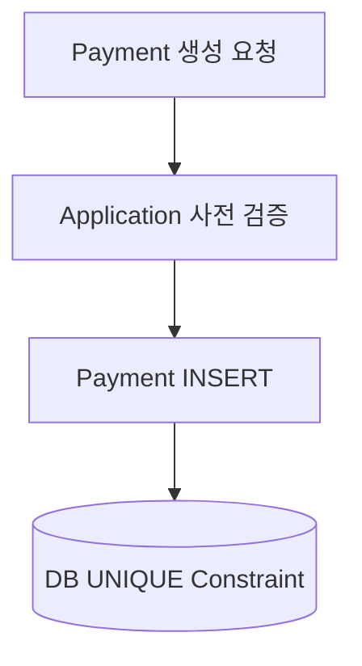

Reservation과 Payment 관계에서 `reservation_id`에 UNIQUE 제약을 적용하여 동일 예약에 여러 Payment가 생성되지 않도록 했습니다.

### 동시성 테스트

동일 Reservation에 대해 두 개의 독립적인 요청을 동시에 실행했습니다.

| 항목 | 결과 |
| --- | ---: |
| 동시 요청 | 2건 |
| 성공 | **1건** |
| 실패 | **1건** |
| 최종 Payment | **1건** |

### 결과

> **애플리케이션 사전 검증과 DB UNIQUE Constraint를 함께 적용하여 동시 요청에서도 하나의 Payment만 생성되는 것을 검증했습니다.**

---

## 3. 결제 승인 ↔ 예약 만료 Race Condition

### 문제 원인

결제 승인과 예약 만료가 거의 동시에 실행되면 두 로직이 동일한 Reservation 상태를 변경하려는 Race Condition이 발생할 수 있습니다.

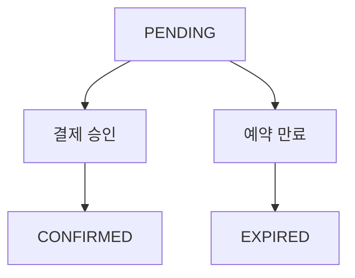

### 검증

결제 승인과 예약 만료를 독립적인 트랜잭션으로 동시에 실행하여 상태 경쟁 상황을 재현했습니다.

### 결과

만료 처리가 먼저 완료된 경우 Reservation은 `PENDING → EXPIRED`로 전이되며, 이후 결제 승인 요청은 실패하도록 처리했습니다.

좌석 역시 한 번만 복구되는 것을 확인했습니다.

> 이를 통해 **동시 실행을 직렬화하는 것과 올바른 비즈니스 상태를 결정하는 것은 별개의 문제**라는 점을 확인했습니다.

---

## 4. AWS 배포 후 Redis Health Check 장애

### 문제 상황

AWS 배포 이후 Spring Boot는 실행되었지만 Actuator Health Check가 다음과 같이 나타났습니다.

```json
{
  "status": "DOWN"
}
```

HTTP 응답 역시 `503` 상태였습니다.

### 원인

운영 환경에서 Redis Host가 `localhost:6379`를 바라보고 있어 Redis Health Check가 실패하고 있었습니다.

### 해결

ElastiCache Valkey를 구성하고 Security Group과 Parameter Store의 `REDIS_HOST`, `application-prod.yaml`을 연결했습니다.

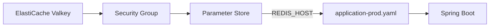

### 결과

```json
{
  "status": "UP"
}
```

Actuator Health Check가 정상화되었고 ALB Target 역시 **Healthy** 상태로 전환되었습니다.

이후 Instance Refresh 배포가 정상적으로 완료되는 것을 확인했습니다.

---

## 5. 과부하 제어 (로컬 세마포어)

**문제 원인**
- 부하를 올려 보면 병목은 CPU · 메모리가 아니라 DB 커넥션 풀이었습니다 (포화 구간에서 앱 CPU 약 54%, MySQL CPU 약 24%, HikariCP 커넥션 50 / 50 사용 중).
- 유입이 처리 능력을 넘으면 커넥션을 기다리는 요청이 계속 쌓여, 이미 받아 준 요청까지 느려집니다.
- 기존 RateLimiter는 초당 200,000건으로 설정되어 있어 과부하 보호 역할을 하지 못했습니다.

**기술 교체**
- **로컬 세마포어 (동시 처리 한도 40):** 예약 트랜잭션 구간의 동시 실행 수를 커넥션 풀(50)보다 작게 묶어 풀 고갈을 막습니다.
- **짧은 대기 후 거절:** 자리가 없으면 잠깐만 기다리고, 그 이상은 `503 + Retry-After`로 바로 거절합니다. `Retry-After`는 1~3초 중 무작위라 거절된 요청이 한 순간에 다시 몰리지 않습니다.
- **매진 확인을 세마포어 앞에:** 매진된 뒤 요청은 자리를 차지하지 않고 바로 거절합니다.

**전후 비교**

테스트 시나리오: 정원이 100명인 회차에 1만 명이 동시에 예약 요청

| 구분 | 표본 수 | p95 (ms) | p99 (ms) | 오류 % | 초당 요청 수 | 초당 처리한 요청 수 | 초당 처리한 트랜잭션 수 | 정원 초과 건수 |
|---|---:|---:|---:|---:|---:|---:|---:|---:|
| 도입 전 | 10,000 | 3,095.9 | 3,130.8 | 0.00 | 2,159.8 | 2,159.8 | 21.6 | 0 |
| 도입 후 | 10,000 | 1,719.0 | 1,734.0 | 0.00 | 3,598.8 | 2,967.6 | 36.0 | 0 |


**성능 개선 요약**
- **응답 시간:** p95 3,095.9 ms → 1,719.0 ms (44.5% 단축, 1.80배 빠름), p99 3,130.8 ms → 1,734.0 ms (44.6% 단축, 1.81배 빠름)
- **처리량:** 초당 처리한 요청 2,159.8건 → 2,967.6건 (37.4% 증가, 1.37배), 초당 처리한 트랜잭션 21.6건 → 36.0건 (66.7% 증가, 1.67배)
- **정합성:** 정원 초과 둘 다 0건

---

## 6. 인기 회차 예약 경합 처리 (Redis Lua 좌석 선점)

**문제 원인**
- 기존 코드는 회차 행을 `SELECT ... FOR UPDATE`로 잠근 뒤 정원을 늘려, 인기 회차 하나에 몰린 요청이 모두 그 한 행의 락에 줄을 섰습니다.
- 좌석이 다 팔린 뒤의 거절 응답까지 줄을 서서 느려지고, 요청마다 DB 트랜잭션 · 커넥션을 붙잡았습니다.
- 같은 회원이 동시에 두 번 요청하면 둘 다 중복 확인을 통과해, 정원 100석 중 11석이 같은 회원의 중복 예약이었습니다.

**기술 교체**
- **Redis Lua 좌석 선점:** '남은 좌석 확인 + 차감'을 Redis 안에서 한 번에 원자적으로 실행해 락 대기를 없앴습니다.
- **같은 회원 확인:** 같은 스크립트에서 같은 회원의 진행 중 예약을 함께 확인해, 중복 요청은 좌석을 잡지 않고 바로 거절합니다 (Redis 호출 수는 그대로).
- **DB 조건부 UPDATE (최종 방어선):** `now_capacity + :count <= max_capacity` 조건으로 정원 초과를 막습니다.
- **정원 마감 선확인:** 매진된 뒤 요청은 트랜잭션을 열기 전에 Redis에서 바로 거절합니다.

**전후 비교**

테스트 시나리오: 서로 다른 회원 200명이 정원이 100명인 회차에 동시에 예약 요청, 그중 50명은 같은 요청을 한 번 더 보냄 (총 250건)

| 구분 | 표본 수 | p95 (ms) | p99 (ms) | 오류 % | 초당 요청 수 | 초당 처리한 요청 수 | 초당 처리한 트랜잭션 수 | 정원 초과 건수 | 중복 예약 건수 |
|---|---:|---:|---:|---:|---:|---:|---:|---:|---:|
| 도입 전 | 250 | 1,569.5 | 1,593.1 | 0.00 | 154.2 | 154.2 | 61.7 | 0 | 11 |
| 도입 후 | 250 | 959.0 | 1,020.4 | 0.00 | 240.5 | 240.5 | 96.2 | 0 | 0 |


**성능 개선 요약**
- **응답 시간:** p95 1,569.5 ms → 959.0 ms (38.9% 단축, 1.64배 빠름), p99 1,593.1 ms → 1,020.4 ms (35.9% 단축, 1.56배 빠름)
- **처리량:** 초당 처리한 요청 154.2건 → 240.5건 (56.0% 증가, 1.56배), 초당 처리한 트랜잭션 61.7건 → 96.2건 (55.9% 증가)
- **정합성:** 중복 예약 11건 → 0건, 정원 초과는 둘 다 0건. 정원 100석은 둘 다 모두 참

---

## 7. 대용량 목록 조회 성능 개선 (페이지네이션, 정렬 키 복합 인덱스, 커서 페이지네이션)

**문제 원인**
- 기존 코드는 페이징 없이 조건에 맞는 예약을 전부 돌려줘, 예약 10만 건이 몰린 날짜는 응답 하나가 약 24.9 MB였습니다.
- 조회 조건(팝업)과 정렬 키(회차 날짜 · 시작 시각)가 회차 테이블에 있어 두 테이블에 걸친 정렬이 되었고, 인덱스로 정렬하지 못해 조건에 맞는 행을 모두 읽은 뒤 `filesort`했습니다.
- OFFSET 페이징은 깊은 페이지일수록 앞의 행을 모두 읽고 버려 느려집니다.

**기술 교체**
- **페이지네이션 + 조인 제거:** 전체 반환 대신 20건씩 돌려줍니다.
- **정렬 키 복제 + 복합 인덱스:** 회차의 `popup_id`, `schedule_date`, `start_time`을 예약 행에 복제하고 `(popup_id, schedule_date, start_time, id)` 인덱스로 `filesort` 없이 20건만 읽고 멈춥니다.
- **커서(키셋) 페이지네이션:** 직전 페이지 마지막 행의 `(schedule_date, start_time, id)` 다음부터 읽어, 깊은 페이지도 첫 페이지와 같은 비용으로 조회합니다. 응답의 `nextCursor`를 다음 요청에 그대로 씁니다.

**전후 비교**

**① 페이지네이션 + 조인 제거**

테스트 시나리오: 예약 10만 건이 몰린 팝업의 특정 날짜 목록을 관리자 5명이 동시에 반복 조회 (전체 예약 100만 건)

| 구분 | 표본 수 | p95 (ms) | p99 (ms) | 오류 % | 초당 처리한 요청 수 | 요청당 SQL 수 | 요청당 DB 실행 시간 (ms) | 스캔 행 수 | 응답 크기 (KB) |
|---|---:|---:|---:|---:|---:|---:|---:|---:|---:|
| 도입 전 | 230 | 2,905.6 | 3,151.3 | 0.00 | 1.9 | 1 | 542.26 | 300,010 | 24,919.9 |
| 도입 후 | 864 | 784.2 | 809.6 | 0.00 | 7.2 | 1 | 335.78 | 200,030 | 5.0 |


**② 정렬 기준 복합 인덱스**

테스트 시나리오: 예약 10만 건이 몰린 팝업의 특정 날짜 목록을 관리자 5명이 동시에 반복 조회 (전체 예약 100만 건)

| 구분 | 표본 수 | p95 (ms) | p99 (ms) | 오류 % | 초당 처리한 요청 수 | 스캔 행 수 | DB 실행 시간 (ms) |
|---|---:|---:|---:|---:|---:|---:|---:|
| 도입 전 | 864 | 784.2 | 809.6 | 0.00 | 7.2 | 200,030 | 335.78 |
| 도입 후 | 178,689 | 3.8 | 4.5 | 0.00 | 1,489.2 | 80 | 1.04 |


**③ 커서 페이지네이션**

테스트 시나리오: 예약 10만 건이 몰린 팝업의 특정 날짜 목록 전체를 1쪽부터 5,000쪽까지 차례로 조회

| 구분 | 앞쪽 응답 p95 (1~100쪽, ms) | 뒤쪽 응답 p95 (4,901~5,000쪽, ms) | 깊이에 따른 증가 (뒤쪽 ÷ 앞쪽, 배) | 5,000쪽 전체 탐색 시간 (초) |
|---|---:|---:|---:|---:|
| 도입 전 | 5.9 | 228.4 | 38.7 | 508.2 |
| 도입 후 | 4.0 | 2.3 | 0.6 | 12.9 |


**성능 개선 요약**
- **① 페이지네이션 + 조인 제거**
    - **응답 시간:** p95 2,905.6 ms → 784.2 ms (73.0% 단축, 3.71배 빠름), p99 3,151.3 ms → 809.6 ms (74.3% 단축, 3.89배 빠름)
    - **처리량:** 초당 처리한 요청 1.9건 → 7.2건 (3.79배)
    - **응답 크기:** 24,919.9 KB → 5.0 KB (10만 건 전체 → 20건). DB 실행 시간은 542.26 ms → 335.78 ms로 38.1%만 줄어 정렬 비용이 남음 (②에서 해결)
- **② 정렬 기준 복합 인덱스**
    - **응답 시간:** p95 784.2 ms → 3.8 ms (99.5% 단축, 206배 빠름), p99 809.6 ms → 4.5 ms (99.4% 단축, 180배 빠름)
    - **처리량:** 초당 처리한 요청 7.2건 → 1,489.2건 (207배)
    - **DB:** 스캔 행 200,030 → 80, DB 실행 시간 335.78 ms → 1.04 ms (99.7% 단축)
- **③ 커서 페이지네이션**
    - **뒤쪽 응답 p95:** 228.4 ms → 2.3 ms (99.0% 단축, 99배 빠름)
    - **깊이에 따른 증가:** 38.7배 → 0.6배 (커서는 쪽 번호와 상관없이 일정)
    - **5,000쪽 전체 탐색:** 508.2초 → 12.9초 (97.5% 단축, 39배 빠름)

---

## 8. 일정 목록 조회 캐시 (Redis 캐시 + 논리 만료)

**문제 원인**
- 같은 팝업 · 날짜의 일정 목록을 초당 2,000건 조회하면 같은 SQL이 초당 약 2,000번 DB로 갑니다.
- 캐시를 넣어도 만료되는 순간 기다리던 요청이 한꺼번에 DB로 몰립니다 (Cache Stampede).

**기술 교체**
- **Redis 캐시 (3초):** 값과 갱신 시각을 함께 저장하고, Redis 키의 TTL은 그 2배로 둡니다.
- **논리 만료:** 갱신 시각이 지나면 락을 잡은 1건만 DB에서 갱신하고, 나머지 요청은 기다리지 않고 기존 값을 바로 돌려줍니다.
- **키가 없을 때:** 1건만 DB를 읽어 캐시를 채우고, 나머지는 최대 50 ms 동안 2 ms 간격으로 캐시를 다시 보며 기다립니다.

**전후 비교**

테스트 시나리오: 같은 팝업 · 날짜의 일정 목록을 초당 2,000건 조회

| 구분 | 표본 수 | p95 (ms) | p99 (ms) | 오류 % | 초당 처리한 요청 수 | 적중 응답 p99 (ms) | 미적중 응답 p99 (ms) | 만료 직후 1초 DB 조회 수 |
|---|---:|---:|---:|---:|---:|---:|---:|---:|
| 캐시 없음 | 240,001 | 4.3 | 8.4 | 0.00 | 2,000.1 | — | 8.4 | 2,016 |
| 캐시 + 동시 재생성 제어 | 240,001 | 1.6 | 3.5 | 0.00 | 2,000.1 | 1.0 | 11.2 | 1 |


**성능 개선 요약**
- **응답 시간:** p95 4.3 ms → 1.6 ms (62.8% 단축, 2.69배 빠름), p99 8.4 ms → 3.5 ms (58.3% 단축, 2.40배 빠름)
- **DB 부하:** 만료 직후 1초 DB 조회 2,016건 → 1건
- **처리량:** 둘 다 초당 2,000건, 오류 0건

---

## 9. 대량 예약 만료 처리 (청크 단위 트랜잭션, SKIP LOCKED 다중 워커)

**문제 원인**
- 기존 코드는 만료 대상을 한 번에 모두 메모리로 읽은 뒤(스캔 970,916행), 예약마다 트랜잭션을 열어 예약 · 회차 행을 잠그고 하나씩 처리했습니다.
- 대상을 청크로 나눠 읽어도 처리 시간은 줄지 않았습니다. 시간은 읽기가 아니라 예약마다 트랜잭션을 열고 회차 행을 잠그는 데 쓰였습니다.
- 워커 하나가 청크를 차례로 처리해, 대상이 많을 때 여러 워커가 나눠 처리할 수 없었습니다.

**기술 교체**
- **청크 단위 트랜잭션:** 청크 100건마다 트랜잭션 하나로 잠금 → 일괄 만료 → 회차별 좌석 일괄 반환을 합니다. 청크가 실패하면 그 청크만 되돌리고 건별로 다시 처리합니다.
- **청크 크기 100:** 사전 측정에서 100 · 500 · 1,000 중 가장 빠르고 락을 가장 짧게 쥡니다 (처리 시간 12.7 · 16.1 · 21.1초, 트랜잭션 최대 90 · 444 · 1,113 ms).
- **`FOR UPDATE SKIP LOCKED` 다중 워커:** 다른 워커가 잠근 행은 기다리지 않고 건너뛰어, 워커들이 남은 청크를 중복 없이 나눠 처리합니다. READ COMMITTED와 회차 id 순 잠금으로 교착 상태를 막았습니다.

**전후 비교**

**① 청크 처리 · 청크 단위 트랜잭션**

테스트 시나리오: 전체 예약 100만 건 중 만료된 예약 2만 건을 처리, 처리하는 동안 만료 대상과 같은 회차에 예약 요청 초당 400건. 만료 대상을 여러 회차 분산 / 한 인기 회차 집중으로 놓고 각각 측정 

**여러 회차 분산**

| 단계 | 처리 시간 (초) | 초당 처리 건수 | 스캔 행 수 | 앱 메모리 최대 (MB) | 락 보유 시간 최대 (ms) | 배치 전 예약 API p99 (ms) | 배치 중 예약 API p99 (ms) | 처리 시간 단축률 |
|---|---:|---:|---:|---:|---:|---:|---:|---:|
| 도입 전 | 446.2 | 45 | 970,916 | 1,353 | 243.3 | 35.5 | 34.2 | — |
| 도입 후 | 17.7 | 1,128 | 20,000 | 1,731 | 255.8 | 34.7 | 89.0 | 96.0% |

**한 인기 회차 집중**

| 단계 | 처리 시간 (초) | 초당 처리 건수 | 락 보유 시간 최대 (ms) | 배치 전 예약 API p99 (ms) | 배치 중 예약 API p99 (ms) | 처리 시간 단축률 |
|---|---:|---:|---:|---:|---:|---:|
| 도입 전 | 876.0 | 23 | 4,058.2 | 27,685.8 | 28,342.3 | — |
| 도입 후 | 72.5 | 276 | 647.6 | 473.6 | 487.3 | 91.7% |


**② 다중 워커**

테스트 시나리오: 만료된 예약 10만 건을 워커 1, 2, 4개가 나눠 처리. 만료 대상을 여러 회차 분산 / 한 인기 회차 집중으로 놓고 각각 측정

**여러 회차 분산**

| 워커 수 | 처리 시간 (초) | 초당 처리 건수 | 중복 처리 건수 |
|---|---:|---:|---:|
| 1 (도입 전) | 66.8 | 1,496 | 0 |
| 2 | 30.7 | 3,263 | 0 |
| 4 | 19.1 | 5,249 | 0 |

**한 인기 회차 집중**

| 워커 수 | 처리 시간 (초) | 초당 처리 건수 | 중복 처리 건수 |
|---|---:|---:|---:|
| 1 (도입 전) | 8.8 | 11,339 | 0 |
| 2 | 5.9 | 17,007 | 0 |
| 4 | 6.0 | 16,728 | 0 |


**③ 장애 후 재처리**

테스트 시나리오: 여러 회차에 분산된 만료 예약 10만 건을 처리하는 도중 앱을 강제 종료하고 다시 켬 (결제 만료 스케줄러 5초 주기)

| 구분 | 복구 시간 | 만료 누락 | 좌석 중복 반환 |
|---|---:|---:|---:|
| 도입 전 | 435.2 | 0 | 0 |
| 도입 후 | 17.6 | 0 | 0 |


**성능 개선 요약**
- **① 청크 처리 · 청크 단위 트랜잭션**
    - **처리 시간:** 분산 446.2초 → 17.7초 (96.0% 단축, 25.2배 빠름), 집중 876.0초 → 72.5초 (91.7% 단축, 12.1배 빠름)
    - **처리량:** 초당 처리 건수 분산 45건 → 1,128건, 집중 23건 → 276건
    - **스캔 행:** 970,916 → 20,000 (만료 대상만 읽음). 집중의 락 보유 시간 최대 4,058.2 ms → 647.6 ms (84.0% 단축)
    - 배치 중 예약 API p99는 분산에서 34.2 ms → 89.0 ms로 늘어남
- **② 다중 워커**
    - **분산:** 워커 1 → 2 → 4에서 처리 시간 66.8초 → 30.7초 → 19.1초 (워커 4에서 71.4% 단축, 3.50배 빠름)
    - **집중:** 8.8초 → 5.9초 → 6.0초 (워커 2에서 33.0% 단축, 워커 4는 2와 같음)
    - **정합성:** 모든 경우 중복 처리 0건
- **③ 장애 후 재처리**
    - **복구 시간:** 435.2초 → 17.6초 (96.0% 단축, 24.7배 빠름)
    - **정합성:** 만료 누락 · 좌석 중복 반환 둘 다 0건

---

## 10. 예약 정합성 — 멱등성과 장애 복구 (상태 조건 UPDATE, 정원 재동기화, Transactional Outbox)

**문제 원인**
- 기존 코드는 잠그기 전에 읽어 둔 상태로 취소 여부를 판단해, 같은 예약에 취소 10건이 동시에 들어오자 이미 취소된 예약의 좌석을 847번 더 돌려줬습니다.
- 결제 확정과 만료 배치가 같은 결제 대기 예약을 동시에 처리하면, 확정된 예약의 좌석이 반환될 수 있었습니다.
- 정원이 Redis와 DB 두 곳에 있어, 앱이 죽거나 Redis 데이터가 사라지면 두 값이 어긋난 채 남았습니다.
- 좌석 반환을 커밋 직후 Redis에 바로 반영해, Redis 연결이 끊긴 동안의 반환이 사라졌습니다.

**기술 교체**
- **상태 조건 UPDATE:** `UPDATE ... WHERE id = :id AND status IN (:from)` 한 문장으로 확인과 변경을 함께 해, 같은 요청이 동시에 몇 번 와도 한 번만 성공합니다. 이미 처리된 재요청은 좌석을 건드리지 않고 성공 응답을 돌려줍니다.
- **확정 · 만료 경쟁:** 만료 배치는 `SKIP LOCKED`로 확정이 잠근 예약을 건너뛰고, 만료 UPDATE는 `status = 'PENDING'` 조건이라 먼저 확정된 예약은 바뀌지 않습니다.
- **정원 재동기화 (1분 주기):** DB와 Redis의 회차 정원을 비교해, 다음 주기에도 같은 차이가 보이면 DB 값으로 고칩니다.
- **Transactional Outbox:** 좌석 반환 이벤트를 좌석을 돌려준 트랜잭션 안에 저장하고, 커밋 직후 반영과 0.2초 주기 중계기가 Redis에 반영합니다. 이벤트마다 적용 표시를 남겨 두 번 반영되지 않습니다.

**전후 비교**

**① 예약 상태 전이 멱등성**

테스트 시나리오: 확정된 예약 1,000건마다 같은 취소 요청을 10건씩, 다른 확정 예약 1,000건마다 같은 체크인 요청을 10건씩 동시에 보냄

| 구분 | 표본 수 | p95 (ms) | p99 (ms) | 오류 % | 좌석 중복 반환 건수 | 중복 체크인 성공 건수 | 미복구 불일치 건수 |
|---|---:|---:|---:|---:|---:|---:|---:|
| 도입 전 | 20,000 | 1,542.0 | 3,103.7 | 0.00 | 847 | 0 | 847 |
| 도입 후 | 20,000 | 277.7 | 394.2 | 0.00 | 0 | 0 | 0 |


**② 결제 확정과 만료의 경쟁**

테스트 시나리오: 결제 대기 예약 1,000건에 결제 확정과 만료를 같은 순간에 실행

| 구분 | 경쟁 건수 | 확정으로 끝남 | 만료로 끝남 | 상태 · 좌석 불일치 건수 | 확정 처리 p99 (ms) |
|---|---:|---:|---:|---:|---:|
| 도입 전 | 1,000 | 1,000 | 0 | 0 | 27.1 |
| 도입 후 | 1,000 | 8 | 992 | 0 | 13.7 |


**③ 장애 후 정원 대사**

테스트 시나리오: 예약 요청 초당 400건이 걸린 중에 장애를 일으키고, 장애가 끝난 뒤 4분 동안 Redis 정원과 DB 정원이 같아지는지 관찰

| 장애 | 장애 직후 불일치 회차 수 (도입 전 / 도입 후) | 도입 전 불일치 회차 수 | 도입 후 복구 시간 (초) | 도입 후 불일치 회차 수 |
|---|---:|---:|---:|---:|
| 앱 강제 종료 | 2 / 14 | 0 | 96.3 | 0 |
| Redis 데이터 유실 | 100,017 / 100,017 | 100,017 | 175.3 | 0 |
| Redis 강제 종료 후 재시작 | 11,939 / 12,016 | 11,939 | 114.1 | 0 |


**④ 좌석 반환 Outbox**

테스트 시나리오: 회차 10개(정원 100)의 확정 예약 1,000건을 섞어 초당 50건씩 취소하는 동안(20초), 시작 5초 뒤 Redis 연결을 약 12초 끊었다가(컨테이너 정지, 저장 후 종료라 값은 그대로) 다시 연결. 정원 재동기화는 꺼서 반환 경로만 봄

그래프: Redis 연결이 끊긴 동안 쌓였다가 재연결 뒤 줄어드는 미처리 이벤트 수(도입 후), Redis와 DB가 어긋난 좌석 수(도입 전 · 도입 후)

| 구분 | 취소 요청 | 미처리 이벤트 최대 | 전달 지연 p99 (정상 구간 / 끊긴 동안 생긴 이벤트) | 복구 시간 (초) | 중복 효과 | 미복구 불일치 | 취소 응답 p95 / p99 (ms) | 오류 % |
|---|---:|---:|---:|---:|---:|---:|---:|---:|
| 도입 전 | 1,000 | — | — | 복구 안 됨 | 0 | 350석 (회차 5개) | 4,613.2 / 4,733.2 | 0.00 |
| 도입 후 | 1,000 | 593 | 25.0 ms / 11,658.3 ms | 0.28 | 0 | 0 | 31.8 / 110.9 | 0.00 |


**성능 개선 요약**
- **① 예약 상태 전이 멱등성**
    - **응답 시간:** p95 1,542.0 ms → 277.7 ms (82.0% 단축, 5.55배 빠름), p99 3,103.7 ms → 394.2 ms (87.3% 단축, 7.87배 빠름)
    - **정합성:** 좌석 중복 반환 847건 → 0건, 미복구 불일치 847건 → 0건. 중복 체크인은 둘 다 0건
- **② 결제 확정과 만료의 경쟁**
    - **정합성:** 상태 · 좌석 불일치 둘 다 0건 (한 예약은 확정 · 만료 중 한쪽으로만 끝남. 어느 쪽이 이기는지는 처리 순서에 따라 달라짐)
    - **확정 처리 p99:** 27.1 ms → 13.7 ms (49.4% 단축, 1.98배 빠름)
- **③ 장애 후 정원 대사**
    - **Redis 데이터 유실:** 4분 뒤 불일치 회차 100,017개 → 0개 (175.3초에 복구)
    - **Redis 강제 종료 후 재시작:** 4분 뒤 불일치 회차 11,939개 → 0개 (114.1초에 복구)
    - **앱 강제 종료:** 어긋난 회차가 2 · 14개로 적고, 도입 후는 96.3초에 0개. 도입 전도 관찰 끝 무렵 0개
- **④ 좌석 반환 Outbox**
    - **정합성:** Redis가 끊긴 동안 사라진 좌석 반환 350석 → 0석. 재연결 0.28초 뒤 쌓인 이벤트 593건을 모두 반영, 중복 반영 0건
    - **취소 응답:** p95 4,613.2 ms → 31.8 ms (99.3% 단축), p99 4,733.2 ms → 110.9 ms (97.7% 단축)
    - **전달 지연:** 정상 구간 p99 25.0 ms

---

## 11. 예약 대기열 · 입장량 제어 (Redis 대기열, 진입 때 확정)

**문제 원인**
- 대기열 없이 1만 명이 한 회차에 몰리면 요청의 94.53%가 과부하 거절(503)되고 초당 188.5건만 처리됩니다.
- 정원이 적은 회차에서는 거절된 요청이 다시 시도하며 경쟁해, 먼저 신청한 사람이 아니라 먼저 다시 온 사람이 좌석을 가져갑니다.
- 입장 토큰 방식 대기열도 입장한 회원끼리 다시 예약을 경쟁해 순서가 지켜지지 않았습니다.

**기술 교체**
- **진입 = 예약 신청:** 대기 번호를 발급하는 Lua 안에서 바로 좌석을 확정하고 결과를 진입 응답으로 돌려줍니다. 정원이 차면 뒤이은 신청은 진입 응답에서 바로 매진을 받습니다.
- **DB 저장:** 확정 기록을 Redis Stream에 남기고 DB 쓰기 작업자가 묶어서 예약 행을 만듭니다. 회차 사용 좌석은 묶음마다 조건부 UPDATE 한 번이라 DB의 정원 최종 방어선은 그대로입니다.
- **우회 방지:** 대기열이 켜진 회차는 예약 API로 바로 예약할 수 없습니다 (403).

**전후 비교**

**① 대기열 적용 근거 — 동시 요청과 처리량**

테스트 시나리오: ② 도입 전 설정(대기열 끔 · 과부하 제어 켬)에서 1만 명이 한 회차에 동시에 예약 요청. 모든 요청이 실제 예약 처리를 거치도록 회차 정원은 1만 명

| 동시 요청 수 (건) | 초당 처리한 요청 수 | 오류 % | 과부하 거절 % |
|---:|---:|---:|---:|
| 10,000 | 188.5 | 0.00 | 94.53 |


**② 대기열 — 도입 전후 비교**

테스트 시나리오: 정원이 100명인 회차에 1만 명이 동시에 예약 신청. 도입 전은 예약 API로 요청하고 거절(503)되면 다시 시도, 도입 후는 대기열 진입으로 신청(인원 1명)한 뒤 결과를 확인

| 구분 | 최종 예약 완료량 | 매진까지 걸린 시간 (ms) | 예약 완료까지 걸린 시간 p95 (ms) | 예약 완료까지 걸린 시간 p99 (ms) | 순서 역전 건수 | 대기 시간 p95 (ms) | 대기 시간 p99 (ms) | 과부하 거절 (503) 건수 | 오류 % | 대기열 접수 처리량 (초당) | 중복 진입 | 우회 예약 (예약 API 직접) | 진입 응답 p95 (ms) | 진입 응답 p99 (ms) | 상태 확인 응답 p95 (ms) | 상태 확인 응답 p99 (ms) |
|---|---:|---:|---:|---:|---:|---:|---:|---:|---:|---:|---:|---:|---:|---:|---:|---:|
| 도입 전 | 100 | 3,735 | 3,155 | 3,441 | 51 | — | — | 3,154 | 0.00 | — | — | — | — | — | — | — |
| 도입 후 | 100 | 536 | 232 | 494 | 0 | 232 | 494 | 0 | 0.00 | 2,831.3 | 0 | 0 | 2,289.7 | 2,567.2 | 1,110.5 | 1,516.4 |


**③ 대기열 접수 · 정합성 — 도입 후**

테스트 시나리오: ② 도입 후와 같은 실행

| 대기열 접수 처리량 (초당) | 중복 진입 | 우회 예약 (예약 API 직접) |
|---:|---:|---:|
| 2,831.3 | 0 | 0 |


**성능 개선 요약**
- **① 대기열 적용 근거**
    - 대기열 없이 1만 명이 몰리면 94.53%가 과부하 거절(503)되고 초당 188.5건만 처리 → 몰린 요청을 줄 세워 차례로 처리할 대기열이 필요
- **② 대기열 도입 전후**
    - **매진까지 걸린 시간:** 3,735 ms → 536 ms (85.6% 단축, 6.97배 빠름)
    - **예약 완료까지 걸린 시간:** p95 3,155 ms → 232 ms (92.6% 단축), p99 3,441 ms → 494 ms (85.6% 단축)
    - **결제 진입:** 결제에 쓰는 예약 id는 p95 1,639 ms에 받아 도입 전 예약 완료 p95보다 48.1% 짧음
    - **공정성:** 순서 역전 51건 → 0건, 과부하 거절(503) 3,154건 → 0건. 중복 진입 · 우회 예약 0건
- **③ 대기열 접수 · 정합성**
    - 1만 명의 대기열 진입을 초당 2,831.3명으로 접수, 중복 진입 · 우회 예약 0건

---

## 테스트

핵심 비즈니스 로직뿐 아니라 데이터 정합성이 중요한 예약과 결제 영역에는 별도의 동시성 테스트를 구성했습니다.

### 주요 테스트

| 영역 | 테스트 |
| --- | --- |
| Auth | `AuthServiceTest` |
| Member | `MemberControllerTest`, `MemberServiceTest` |
| Payment | `PaymentTest`, `PaymentRepositoryTest`, `KakaoPayProviderTest`, `KakaoPayProviderConcurrencyTest` |
| Reservation | `ReservationTest`, `ReservationControllerTest`, `AdminAuthorizationTest`, `ReservationServiceTest`, `ReservationBookingServiceTest` |
| Reservation | `ReservationCancelManagerTest`, `ReservationTimeoutProcessorTest`, `ReservationRepositoryChunkQueryTest` |
| Reservation 목록 조회 | `ReservationListQueryTest`, `ReservationCursorTest` |
| Queue | `ReservationQueueServiceRedisTest`, `QueueReservationWriterRedisTest`, `QueueReservationPersisterTest` |
| Concurrency | `BookingAdmissionTest`, `ReservationClaimSkipLockedTest`, `ReservationNumberGeneratorTest` |
| Schedule | `ScheduleTest`, `ScheduleServiceTest`, `ScheduleStatusUpdateTest`, `ScheduleCapacityUpdateTest` |
| Schedule Redis | `ScheduleCapacityCacheTest`, `ScheduleCapacityResyncerTest`, `ScheduleListCacheTest`, `SeatReleaseEventRedisTest` |
| Outbox | `SeatReleaseOutboxTest`, `OutboxEventRepositoryTest`, `OutboxRelayTest`, `SeatReleaseKafkaConsumerTest` |
| Lock | `PessimisticLockSupportTest` |
| QR | `QrServiceTest` |
| Crawler | `PopupCrawlerTest` |

### CI 테스트 자동화

Pull Request가 생성되면 GitHub Actions에서 자동으로 검증합니다.

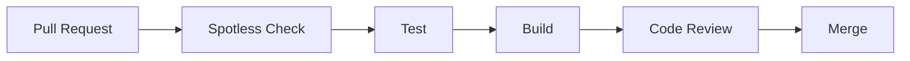

---

## CI/CD & AWS

### AWS 구축 현황

| 영역 | 적용 내용 | 상태 |
| --- | --- | :---: |
| VPC | POP'N UP 전용 VPC | 완료 |
| Subnet | Public / Private Subnet | 완료 |
| NAT Gateway | Private EC2 외부 통신 | 완료 |
| Security Group | ALB → EC2 → RDS / Valkey 접근 제어 | 완료 |
| RDS | MySQL 운영 DB | 완료 |
| Parameter Store | 운영 DB / Redis 설정 관리 | 완료 |
| ECR | Docker Image Repository | 완료 |
| IAM / OIDC | GitHub Actions AWS 인증 | 완료 |
| Launch Template | EC2 실행 환경 관리 | 완료 |
| Auto Scaling Group | EC2 자동 관리 | 완료 |
| Target Group | EC2:8080 연결 | 완료 |
| ALB | 외부 요청 전달 | 완료 |
| Actuator | Health Check | 완료 |
| ElastiCache | Valkey 운영 Redis | 완료 |
| Instance Refresh | 새 Version 자동 교체 | 완료 |
| Auto Scaling Policy | 평균 CPU 30% Target Tracking | 완료 |
| Scale-Out | EC2 1 → 2 실검증 | 완료 |
| Scale-In | EC2 2 → 1 | 완료 |
| Route 53 | 도메인 연결 | 완료 |
| ACM | SSL 인증서 | 완료 |
| HTTPS | ALB 443 / Redirect | 완료 |

---

### CI/CD Pipeline

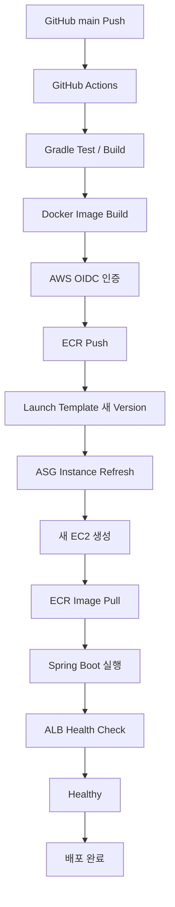

### 배포 방식

GitHub Actions에서 AWS Access Key를 장기간 저장하는 방식 대신 **OIDC 기반 IAM Role 인증**을 사용했습니다.

새로운 Docker Image가 ECR에 Push되면 새로운 Launch Template Version을 생성하고 Auto Scaling Group의 Instance Refresh를 통해 새로운 EC2로 교체하도록 구성했습니다.

---

### Auto Scaling 실검증

Target Tracking Policy의 평균 CPU 목표값을 **30%**로 설정했습니다.

실제 EC2에 CPU 부하를 발생시켜 Scale-Out을 검증했습니다.

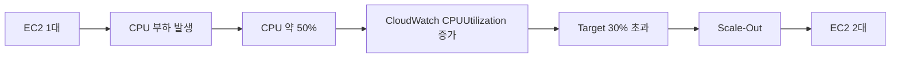

### 결과

> **실제 CPU 부하 발생 후 Auto Scaling Group의 EC2가 1대에서 2대로 증가하는 것을 확인했습니다.**

Scale-Out 설정을 구성하는 데 그치지 않고 실제 CloudWatch Metric과 Scaling Policy가 동작하는 것을 검증했습니다.

---

## 모니터링

부하 테스트와 AWS 운영 검증 과정에서 다음 지표를 확인했습니다.

| 지표 | 활용 목적 |
| --- | --- |
| k6 avg / p95 / p99 | API 응답 지연 분석 |
| k6 Dropped Iterations | 시스템 처리 한계 확인 |
| HikariCP Active / Max | DB Connection Pool 포화 확인 |
| Docker CPU / Memory | Application / MySQL Resource 확인 |
| Actuator Health | Application 및 의존 서비스 상태 확인 |
| CloudWatch CPUUtilization | EC2 부하 및 Auto Scaling 판단 |
| ALB Target Health | Instance 정상 여부 확인 |

### 모니터링을 통해 확인한 내용

- CPU / Memory보다 DB Connection Pool이 먼저 포화되는 현상 확인
- HikariCP `50 / 50` 상태와 HTTP 응답 지연의 관계 확인
- CloudWatch CPUUtilization 증가에 따른 Auto Scaling 동작 확인
- Redis 연결 장애가 Actuator와 ALB Health Check에 미치는 영향 확인

---

## 프로젝트 성과

| 핵심 지표 | 결과 |
| --- | ---: |
| 안정 처리량 측정 | **약 800 req/s** |
| HikariCP 병목 | **50 / 50 포화 확인** |
| 동시 결제 요청 | **2건 → Payment 1건 유지** |
| AWS Scale-Out | **EC2 1 → 2 실검증** |
| 과부하 제어 p95 (1만 명 동시 예약) | **3,095.9 → 1,719.0 ms (44.5% ↓)** |
| 같은 회원 중복 예약 (Redis Lua 좌석 선점) | **11건 → 0건** |
| 목록 조회 p95 (복합 인덱스) | **784.2 → 3.8 ms (206배 빠름)** |
| 캐시 만료 직후 1초 DB 조회 | **2,016건 → 1건** |
| 만료 예약 2만 건 처리 시간 (여러 회차 분산) | **446.2 → 17.7초 (96.0% ↓)** |
| 동시 취소 좌석 중복 반환 | **847건 → 0건** |
| 대기열 순서 역전 (1만 명 · 정원 100) | **51건 → 0건** |

---

## 프로젝트 구조

```text
src/main/java/com/popnup
├── PopnupApplication.java
│
└── popnupbackend
    ├── domain
    │   ├── admin
    │   ├── auth
    │   ├── member
    │   ├── payment
    │   ├── popup
    │   ├── qrcode
    │   ├── reservation
    │   └── schedule
    │
    └── global
        ├── common
        ├── config
        ├── crawler
        ├── entity
        ├── error
        ├── health
        └── security

src/main/resources
├── application.yaml
├── application-local.yaml
├── application-prod.yaml
└── application-test.yaml

.github/workflows
├── ci.yml
├── cicd.yml
└── notification.yml

Dockerfile
docker-compose.yaml
build.gradle
api-test.http
```

---

## 향후 개선

현재 완료된 기능과 아직 검증이 필요한 항목을 구분하여 관리하고 있습니다.

### 성능

- [x] Redis 사전 필터링 적용 후 성능 재측정 → 트러블 슈팅 6
- [ ] Redis 적용 전/후 HikariCP Connection 비교
- [x] Redis 적용 전/후 p95 / p99 비교 → 트러블 슈팅 6
- [x] 조회 성능 Before / After 정량 측정 → 트러블 슈팅 7
- [x] 조회 캐싱 대상 선정 (일정 목록) → 트러블 슈팅 8
- [ ] 캐시 TTL 정책 검증 (지금은 3초 하나만 측정)
- [x] 캐시 적용 전/후 성능 비교 → 트러블 슈팅 8
- [ ] 만료 배치 중 예약 API p99 증가 완화 (여러 회차 분산 34.2 → 89.0 ms) → 트러블 슈팅 9
- [ ] 한 인기 회차에 몰린 만료 처리의 다중 워커 확장 (워커 2 → 4에서 5.9 → 6.0초) → 트러블 슈팅 9
- [ ] 대기열 진입 응답 시간 단축 (진입 응답 p95 2,289.7 ms) → 트러블 슈팅 11

### 모니터링

- [ ] 구조화 로그 정책 보강
- [ ] 로그 레벨 정책 정의
- [ ] 장애 / 이상 상황 감지 체계 보강

### AWS

- [ ] Auto Scaling Scale-In `2 → 1` 최종 검증
- [ ] Route 53 도메인 연결
- [ ] ACM SSL 인증서 적용
- [ ] ALB HTTPS 443 적용
- [ ] HTTP → HTTPS Redirect

---

## 협업 방식

- GitHub Issue 기반 작업 관리
- Feature Branch 기반 개발
- Pull Request를 통한 Code Review
- Branch Protection 적용
- PR Template / Issue Template 사용
- GitHub Actions 기반 CI
- Slack / Discord Workflow 알림

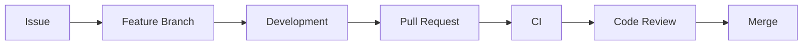

---

<div align="center">

### POP'N UP

**Explore · Reserve · Pay · Check-in**

</div>
